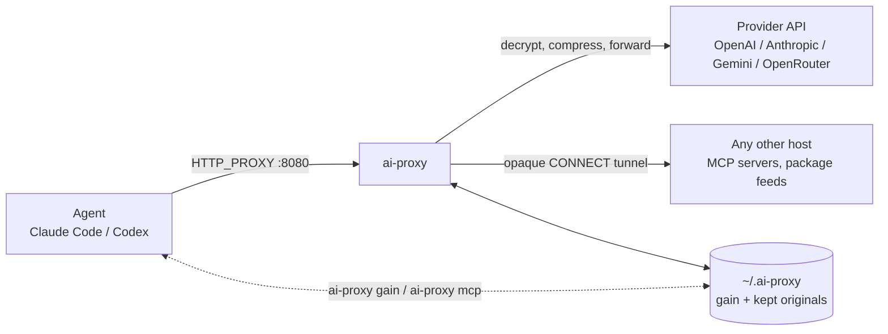

# ai-proxy

[](https://github.com/Arasz/ai-proxy/actions/workflows/build.yml)
[](https://github.com/Arasz/ai-proxy/actions/workflows/publish.yml)
[](https://www.nuget.org/packages/ai-proxy)
[](https://m8ven.ai/mcp/arasz/ai-proxy?s=readme)

A local proxy for AI coding agents. While it runs, it is your system HTTP(S) proxy: it decrypts
traffic to the OpenAI, Anthropic, Gemini and OpenRouter APIs, compresses what the agent sends,
and counts what that saved. Everything else passes through untouched, MCP servers included.
Your agent keeps its own credentials; the proxy has none.



## Quick Start

Install the global tool (needs the [.NET 11 SDK](https://dotnet.microsoft.com/download/dotnet/11.0)):

```bash
dotnet tool install --global ai-proxy
```

Start the proxy and leave it running. The first start asks once to trust its root certificate:

```bash
ai-proxy
```

In another terminal, start your agent through it:

```bash
ai-proxy harness claude
ai-proxy harness codex
```

Then see what it saved:

```bash
ai-proxy gain
```

Something off? `ai-proxy doctor` checks the setup and changes nothing.

## What's new

- Targets .NET 11 and compiles with Runtime Async; `ai-proxy harness` keeps cloud metadata probes off the proxy (0.29.x). [Release notes](docs/changelog/0.29.1-harness-bypass-metadata-ip.md)
- A crash no longer leaves the system pointing at a dead proxy: the guard or the next start restores the settings ai-proxy replaced (0.28.5, 0.28.6). [Release notes](docs/changelog/0.28.6-stale-proxy-restore-target.md)
- `ai-proxy gain` shows a block per harness and per layer, and `ai-proxy shortcut` adds an `aph` command (0.28.0). [Release notes](docs/changelog/0.28.0-gain-per-harness-and-aph.md)
- Codex signed in with ChatGPT is recorded in `gain`, for harness tunnels only (0.27.0). [Release notes](docs/changelog/0.27.0-record-codex-chatgpt-traffic.md)
- `ai-proxy status` and `ai-proxy stop` (0.25.0), and the read-only `ai-proxy doctor` (0.22.0). [Lifecycle](docs/reference/lifecycle.md) · [Doctor](docs/reference/doctor.md)

Every release: [changelog](docs/changelog/README.md).

## What it does

| Feature               | What you get                                                                                         | Docs                                                                            |
|-----------------------|------------------------------------------------------------------------------------------------------|---------------------------------------------------------------------------------|
| Zero-config routing   | Known provider API hosts are decrypted; every other host stays an opaque tunnel                      | [Running the proxy](docs/how-to/running-the-proxy.md#what-the-proxy-sees)       |
| Compression           | Tool output in each request is shrunk before it goes upstream; on by default                         | [Compression](docs/how-to/turning-on-the-compression-stage.md) · [Why](docs/explanation/why-the-proxy-compresses-the-tool-output.md) |
| Recoverable previews  | Long tool output becomes a preview, and the agent reads the original back when it needs it           | [Retrieval](docs/how-to/reading-gain-and-retrieving-originals.md)              |
| Gain                  | Bytes and estimated tokens saved, per project, harness and layer                                     | [Gain](docs/how-to/reading-gain-and-retrieving-originals.md)                   |
| Agent launcher        | `ai-proxy harness` sets proxy, CA and project variables for one child process                        | [Connecting an agent](docs/how-to/connecting-an-agent.md)                      |
| Safe system proxy     | Takes over the OS proxy settings while running and puts the old ones back, even after a crash       | [Lifecycle](docs/reference/lifecycle.md#crash-recovery)                        |
| Setup check           | `ai-proxy doctor` tests the API, HTTPS inspection, the root certificate and your shell variables     | [Doctor](docs/reference/doctor.md)                                             |

Every setting is in [environment variables](docs/reference/environment-variables.md); supported
platforms are in [platforms](docs/reference/platforms.md).

## Running the proxy

```bash
ai-proxy             # start; Ctrl+C stops it and restores your proxy settings
ai-proxy --restart   # replace the running instance gracefully
ai-proxy status      # show the running instance (exit 3 when none)
ai-proxy stop        # end it
ai-proxy mcp         # MCP server that lets an agent read kept originals
```

The proxy listens on `127.0.0.1:8080` and its local API on `127.0.0.1:17432`, both loopback
only. Install, restart rules and what gets decrypted: [Running the proxy](docs/how-to/running-the-proxy.md).

## Project layout

```text
src/AiProxy/             # host: proxy, CLI, local API, MCP server, harness
src/AiProxy.Core/        # rules: provider detection, compression, capture
src/AiProxy.Code/        # code views for C#, Python, JavaScript and TypeScript
src/AiProxy.Storage/     # SQLite store for gain and kept originals
src/AiProxy.Generators/  # source generators and analyzers
tests/                   # xUnit v3 suites
scripts/                 # Python tooling and docs checks
```

Design background: the [ADRs](docs/adr/README.md).

## Documentation

[Documentation tree](docs/README.md): [how-to](docs/how-to/README.md), [explanation](docs/explanation/README.md), [reference](docs/reference/README.md), [ADRs](docs/adr/README.md), [changelog](docs/changelog/README.md).

## Contributing & Security

- [CONTRIBUTING.md](CONTRIBUTING.md) and [CLAUDE.md](CLAUDE.md) hold the repo conventions, including the mandatory TDD workflow.
- Build and test with `dotnet build` and `dotnet test`.
- The proxy can read provider request bodies and credentials. Only run it on a machine you control. See [SECURITY.md](SECURITY.md) for the trust boundary.

## License

[MIT](LICENSE). Copyright (c) 2026 Rafał Araszkiewicz.
