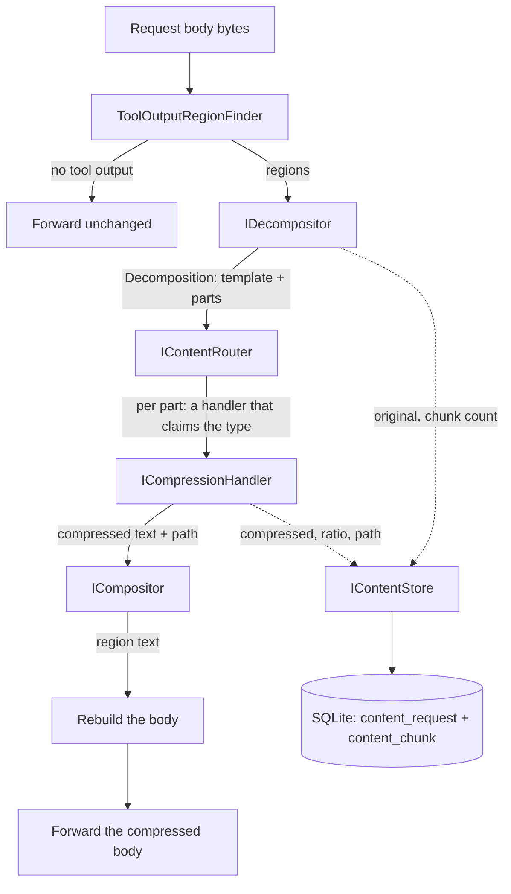

# The content compression pipeline: a router, a set of handlers, and a store that keeps the original

**Date:** 2026-10-22
**Status:** design for review

## What this is

The proxy receives a request from an agent. Somewhere in that request is the output of a tool the
agent ran: a directory listing, a grep result, a log tail, a JSON blob, a source file. That output
is the part of the context that grows without bound, and it is the part the provider pays for.

This design adds a stage that shrinks that output before the provider sees it, and keeps what it
dropped. The shape is the one the research record measured: a content router in front, a reducer
per payload kind, an extractive overlay that re-attaches what the reducer lost, and a store that
keeps the original so the dropped text can be served back.

The pipeline never rewrites the client's words. Every reducer is a subset of the text it was
given, so a fact that survives is intact, and a fact that does not survive is still in the store.

## The stages



Five seams, in the order the data flows. The first four are pure and live in the core project.
The fifth is a port, and its adapter is the only part of this that touches a database.

## The seams

Every interface below lives in `AiProxy.Core`. Every implementation of the storage port lives in
the new `AiProxy.Storage` adapter project, and the host wires them.

### IDecompositor

Takes one region of text and splits it into typed parts.

```csharp
public interface IDecompositor
{
    Decomposition Decompose(string content, string requestId);
}
```

`Decomposition` carries the request id, the original text, the template, and the parts. The
template is the original text with every part replaced by a `{type_chunkId}` placeholder, so
`{log_1}` and `{json_2}` mark where each part was. The compositor fills them back.

The split is by structure, not by guess. A fenced code block, a balanced JSON value and a balanced
XML element are parts; what is left is split on blank lines and each block is classified. A
block that cannot be classified is prose, and a payload that cannot be split at all stays one
part.

### IContentRouter

Picks the handler for a part. The handler decides, not the router: each handler declares the
types it claims, and the router asks them.

```csharp
public interface IContentRouter
{
    ContentRoute Route(ContentPart part);
}
```

### ICompressionHandler

The reduction itself. One implementation per payload kind.

```csharp
public interface ICompressionHandler
{
    bool CanHandle(ContentType type);
    ValueTask<HandledContent> HandleAsync(ContentPart part, CancellationToken cancellationToken);
}
```

`HandledContent` carries the reduced text and the path that produced it, because the store keeps
the path with the content and an operator reading the store needs to know which rule ran.

### ICompositor

Puts the reduced parts back into the template.

```csharp
public interface ICompositor
{
    string Compose(Decomposition decomposition, IReadOnlyList<CompressedPart> parts);
}
```

A part that no handler reduced is composed back as it was, so a missing handler costs bytes and
not correctness.

### IContentStore

The port the core declares and the adapter implements.

```csharp
public interface IContentStore
{
    ValueTask StoreAsync(ContentRecord record, CancellationToken cancellationToken);
    ValueTask<ContentRecord?> GetAsync(string requestId, CancellationToken cancellationToken);
}
```

`ContentRecord` holds the original body, the compressed body, the ratio, the path, the chunk
count and the per-chunk detail. The store is called with the record already built, so the store
never has to know how the compression was decided.

## The data model

```csharp
public enum ContentType
{
    Unknown, Prose, Log, Json, Xml, Toml, Markdown, SourceCode, DirectoryListing, ShellTranscript,
    BuildOutput,
}

public sealed record ContentPart(string RequestId, int ChunkId, ContentType Type, string Text);

public sealed record Decomposition(
    string RequestId, string Original, string Template, IReadOnlyList<ContentPart> Parts);

public sealed record CompressedPart(
    int ChunkId, ContentType Type, string Text, string Path, double Ratio);

public sealed record ContentRecord(
    string RequestId,
    DateTimeOffset CreatedAt,
    string Original,
    string Compressed,
    double Ratio,
    string Path,
    int ChunkCount,
    IReadOnlyList<CompressedPart> Parts);
```

The request id is a version 7 GUID, so the store's rows sort by creation order without a second
column.

## The handlers

Each row is a rule the research record measured, or a rule the record's own format families
imply. The path string is what the store keeps next to the content.

| type | rule | path | basis |
|---|---|---|---|
| Log | keep the lines carrying a signal, plus two anchors at each end, then deduplicate, then the overlay | `log.signal-filter` | measured, 8/8 answers at 0.75 size |
| Json | parse and re-serialise compactly, then the overlay | `json.compact` | measured, 13/14 answers at 0.698 size |
| Xml | parse, drop the indentation whitespace, write without formatting | `xml.compact` | the JSON rule applied to XML |
| Toml | drop the blank lines and the whole-line comments | `toml.strip-comments` | the structural reduce applied to TOML |
| Markdown | drop the HTML comments, collapse the runs of blank lines | `markdown.strip-comments` | the structural reduce applied to Markdown |
| SourceCode | drop the blank lines, keep every other line whole | `sourcecode.blank-lines` | measured, 0.949 size for the model path |
| Prose | deduplicate the repeated lines, then the overlay | `prose.dedupe` | measured, 8/8 answers at 0.75 size |
| Prose, with a model | the extractive model, then the overlay, falling back to the rule path when no model is configured | `prose.model` / `prose.dedupe` | the model is 0.36 s a call and is a no-op on everything that is not prose |
| DirectoryListing | nothing | `listing.pass-through` | measured, 1.0 size, and nothing compresses it without losing file names |
| ShellTranscript | the log rule over the output part | `shell.log-rules` | the log rule, applied to the transcript |
| BuildOutput | keep every MSBuild error and warning whole, drop exact repeats, cut a tool invocation (a line over 500 characters made mostly of paths and switches) to its first 200 plus a marker naming what was dropped; output it cannot shorten goes to the log rule | `build.msbuild` / `log.signal-filter` | measured, 60,672 to 5,367 characters on the verbose build failure |
| Unknown | nothing | `unknown.pass-through` | the safe default |

The must-keep overlay is the same code in every handler that reduces. It re-attaches the
identifiers, numbers, paths and directives the reduction dropped, and it grows five rules that
close the decisions-class hole: a failure verdict, an exit status, a lowercase state transition,
an absolute path, and an explicit directive.

## The store

Two tables and a queue.

```sql
CREATE TABLE content_request (
    request_id     TEXT PRIMARY KEY,
    created_at     TEXT NOT NULL,
    original       TEXT NOT NULL,
    compressed     TEXT NOT NULL,
    ratio          REAL NOT NULL,
    path           TEXT NOT NULL,
    chunk_count    INTEGER NOT NULL
);

CREATE TABLE content_chunk (
    request_id     TEXT NOT NULL,
    chunk_id       INTEGER NOT NULL,
    content_type   TEXT NOT NULL,
    original_text  TEXT NOT NULL,
    compressed_text TEXT NOT NULL,
    path           TEXT NOT NULL,
    ratio          REAL NOT NULL,
    PRIMARY KEY (request_id, chunk_id)
);

CREATE TABLE content_queue (
    job_id         INTEGER PRIMARY KEY AUTOINCREMENT,
    request_id     TEXT NOT NULL,
    payload        TEXT NOT NULL,
    created_at     TEXT NOT NULL
);
```

The queue is the pub/sub channel. The request path writes one row into `content_queue` and
returns; a background worker drains the queue and writes `content_request` and `content_chunk`.
The write to the queue is committed before the request is forwarded, which is what makes "the
original is always kept" true even if the process dies in the next second.

The worker polls, and the poll is gated on `PRAGMA data_version` rather than on a blind timer.
The producer and the poller use separate connections, because the pragma does not move for a
connection's own commits. The database runs in WAL mode so the proxy and any other reader can
share the file.

The alternative, an in-process channel, was rejected for the queue: a channel loses the record
when the process dies, and the promise is that the original is kept.

## The configuration

| variable | default | what it does |
|---|---|---|
| `PROXY_COMPRESSION` | `off` | turns the stage on. It is off by default because the stage changes what the provider sees |
| `PROXY_COMPRESSION_DB` | `~/.ai-proxy/content.db` | where the store lives |
| `PROXY_COMPRESSION_MODEL` | none | the path to the extractive model's ONNX artifact. Without it the prose path is the rule path |
| `PROXY_COMPRESSION_MINIMUM` | `512` | the smallest region worth compressing, in characters |

## What the proxy logs

One line per request that was compressed, with the request id, the paths that ran, the chunk
count, the original size, the compressed size and the ratio. One line per failure to store. The
research record asks for exactly this: the forwarded request is no longer the client's request, so
the proxy has to say what it changed.

## What v1 does not do

- It does not ship a model. The prose path is the measured rule path, and the model path is a
  port with a fallback, because the model artifact is 274 MB and its latency is 0.36 s a call.
- It does not compress the response. Only the request's tool output.
- It does not re-compress in the background. The queue exists so the original survives, not so a
  second pass can improve on the first.
- It does not touch the prompt. Only the tool output regions of the envelope are replaced, and
  the rest of the body stays byte for byte what the client sent.

## The open decisions this design needs reviewed

1. The default is off. Is that right for a proxy whose purpose is to shrink the context?
2. The region finder keys on the three tool-output shapes rather than on an envelope convention.
   Is the value-set matching precise enough, or does it need path tracking?
3. The queue makes the producer a second writer to the database file. Does that break the
   project's single-writer rule, or is a queue table a channel rather than a dataset?
4. The prose path deduplicates lines and re-attaches identifiers. The measured version of that
   rule is 0.75 size on one fixture. Is that enough to justify the stage at all, or should prose
   wait for the model?
5. The overlay's five new rules widen what is protected. A wide overlay eats the savings. What is
   the ceiling?

## What the implementation changed

This is the design as it was written, and the review that followed it changed three things.
The rulings are in
[2026-10-22-compression-design-gate-audit.md](2026-10-22-compression-design-gate-audit.md),
and the code follows them.

The minimum is per kind rather than one number. A single threshold of 512 characters would
have skipped a 300 character log that the log reducer would have reduced by a quarter, so
each kind has its own minimum and the operator's variable overrides them all.

The region finder matches by position rather than by content. The design said the finder
would key on the value of the tool output, and the audit showed that a string elsewhere in
the body with the same words would be rewritten with it. The finder counts the string
values in the parsed document and the string tokens in the raw bytes, and the two counts
agree, so a region is found by where it is and not by what it says.

The overlay has a ceiling, and the decisions-class tokens are the ones that survive it. The
five new rules protect a failure verdict, an exit status, a lowercase state transition, an
absolute path and an explicit directive, and those tokens are kept whatever the ceiling
says, because they are the facts the record calls the highest-value class. The other tokens
are kept while the block stays inside five percent of the reduction.

The XML reducer had a bug the design did not foresee: reading an attribute with a prefix
threw on a document that did not declare the prefix, and the reducer caught the throw and
fell back to the line rule, so it deduplicated instead of compacting. The whitespace that
formats a document and the whitespace that is its content are now told apart, and a test
pins that every reducer takes its own path rather than its fallback.

The same class of defect was in three more places, and it is the one the design's own
promise forbids: a reducer that changes the client's words. A Markdown reducer removed an
HTML comment from inside a code fence, a configuration reducer removed a comment line from
inside a multi-line string, and a source reducer removed a blank line from inside a raw
string. A comment in code is code, a hash in a multi-line string is the value, and a blank
line in a raw string is the value, so each reducer now leaves the literal blocks alone.

One thing the implementation found that the design did not know: the measured script's
deduplication kept every copy of a repeated line. It zeroed the counter of a line it had
already kept, and the next copy then read a counter of zero, which is not more than one.
The port keeps the first copy and drops the repeats, which is what the script's own
docstring said it did.
