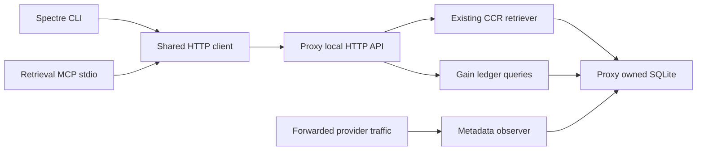

# Research: retrieval MCP and gain clients of the proxy

**Date:** 2026-10-25
**Question:** How can a retrieval MCP server and Spectre CLI share the proxy's retrieval and savings API without duplicating its storage or claiming unmeasured token savings?

## Findings

### F1 — Main has internal CCR retrieval and one public content endpoint [READ]

The existing tool is `proxy_retrieve`, answered inside the provider request loop. It reads a retained original by its 16-hex preview ID and supports lines, pattern and whole modes. The public `GET /content/{requestId}` instead returns the complete original request body by a GUID request ID. The namespaces must stay distinct.

**Evidence:** `src/AiProxy.Core/Content/Ccr/CcrRetrieval.cs`, `CcrRetriever.cs`, `CcrRetrievalRequest.cs`; `src/AiProxy/Hosting/ContentEndpoints.cs`; `src/AiProxy.Storage/SqliteOriginalStore.cs`.

### F2 — The three named quality-report tools do not exist here [READ]

There is no MCP host project on main. `read_file` occurs in input fixtures and tool-call path recognition; there are no `retrieve_original` or `edit_file` handlers. The owner clarified this task adds retrieval only. Adding filesystem reads or edits would expand the domain without serving this request.

**Evidence:** main `856a479`, `AiProxy.slnx`, `src/AiProxy.Core/Content/ToolCallFiles.cs`, `tests/AiProxy.Tests/Unit/Content/ToolOutputFilePathTests.cs`, and the owner's task clarification relayed by the orchestrator on 2026-10-25.

### F3 — Port 5000 serves administration, while 8080 carries forward traffic [READ]

Program creates an ASP.NET host without a URL default; the documentation names its default as localhost:5000. Titanium's separate forward listener defaults to loopback:8080. Changing the communication default must preserve explicit ASP.NET URL overrides and leave the forward listener under `Proxy:Port`.

**Evidence:** `src/AiProxy/Program.cs:18-22`, `src/AiProxy/Hosting/ProxyRuntimeOptions.cs`, `docs/reference/environment-variables.md:107`.

### F4 — Persisted metadata cannot yet answer a gain report [READ]

Content storage has original/compressed text, timestamps, reducer paths and content type. Capture, when enabled, has provider, request/forwarded bytes, reported input/output/cache token usage and timings. It has no project identity, recall events, shadow runs or dedicated statistics interface. Compression and capture IDs are generated separately.

**Evidence:** `src/AiProxy.Storage/ContentSchema.cs`, `SqliteCaptureStore.cs:142-178`, `src/AiProxy.Core/Content/ContentRecord.cs`, `ContentCompressionPipeline.cs`, `src/AiProxy/Hosting/CapturedExchange.cs`, `ProviderRequestInspector.cs`.

### F5 — Existing token counts are estimates with a documented calibration boundary [READ]

CCR uses 2.89 characters per estimated token. The calibration record describes a Claude request-body fit, warns about provider/model and per-payload extrapolation, and does not establish billed-token savings. The API should expose the coefficient and method label alongside character/byte measurements. Provider-reported usage remains a separate nullable fact.

**Evidence:** `src/AiProxy.Core/Content/Ccr/CcrOptions.cs`, `docs/work/2026-10-24-claude-token-calibration.md`.

### F6 — AiRaccoon's generator is a useful pattern with project-specific coupling [READ]

Its incremental generator derives tool names from MCP attributes and rejects missing names. It also emits AiRaccoon-specific scope metadata. Directly referencing that project would retain its hardcoded namespace and scope types. Adapt only the inventory and validation mechanism, with explicit annotation validation appropriate to this server.

**Evidence:** `/Users/arasz/RiderProjects/ai-raccoon/src/AiRaccoon.Generators/McpToolInventoryGenerator.cs:100-135`, `ToolScopeFacts.cs:13-19,31-36`.

### F7 — Explicit false hints need a wire-level assertion [INFERRED]

The MCP schema makes all four hints optional booleans with conservative defaults. The owner requires every hint explicitly emitted. A source attribute check alone cannot prove SDK serialization includes false values; test the actual `tools/list` JSON as well. For retained local originals the values are read-only true, destructive false, idempotent true and open-world false.

This follows the schema and the existing retained-original lookup, which performs a SELECT without refreshing original retention.

**Evidence:** [MCP ToolAnnotations schema](https://github.com/modelcontextprotocol/modelcontextprotocol/blob/main/docs/specification/2025-06-18/schema.mdx); `src/AiProxy.Storage/SqliteOriginalStore.cs`, `FindAsync`.

### F8 — Thin clients are enough for both requested interfaces [INFERRED]

The proxy already owns originals and SQLite. A small HTTP client/contracts library lets a stdio MCP adapter and a Spectre CLI share its API without granting either a database writer. Spectre's documented CommandApp registration and settings supply the requested command surface. A new local RPC protocol or a general plugin framework adds no required behavior.

**Evidence:** F1, F4; [Spectre command configuration](https://spectreconsole.net/cli/how-to/configuring-commandapp-and-commands/); `docs/adr/0001-core-holds-the-rules-and-the-host-holds-the-http.md`, `0002-the-store-is-an-adapter-and-sqlite-is-the-queue.md`.

## Contract to freeze before implementation

This is the proposed contract, not a claim about shipped behavior. The API lane publishes final DTO names before adapters start.

- `AiProxy.Client` owns a typed HTTP client and serialized records. MCP and CLI reference it, with no SQLite or host dependencies.
- Default communication URL is `http://127.0.0.1:17432`. An explicit `--urls` or `ASPNETCORE_URLS` wins; clients accept an explicit endpoint. Avoid routing local HTTP calls back through the machine proxy.
- MCP exposes exactly `retrieve_original`. Its arguments are `id`, `mode` (lines, pattern, whole), optional `start`, `end`, `pattern`, and `context` (default zero). Null optional fields are omitted before schema validation, because the schema allows numbers/strings but not null. Mode must be explicit so full retrieval stays deliberate. IDs are CCR preview IDs, never `/content` GUIDs.
- `POST /retrieval` accepts those arguments and delegates to `CcrRetrievalParser`, `CcrRetriever` and `IOriginalStore`. It returns JSON `{text,error}`, where error is nullable on success. Preserve semantic error codes and caps. MCP sets `isError` on failed retrieval. Bad transport/filter input uses problem details.
- `GET /gain` accepts project, inclusive from, exclusive to, provider, method, rule, layer, pipeline, and bounded historyLimit filters. Return schemaVersion, generatedAt, filters, measurement, summary, history, daily, weekly, monthly, attributions, failures, recalls and capabilities. Empty data returns empty arrays and zero aggregates, with the same shape.
- Measurement identifies `estimated`, coefficient 2.89 and units. Record original versus actual initial forwarded body after tool/continue rewriting; preserve signed deltas, since tool overhead can make the forwarded body larger. Per-event estimated tokens round down as CcrOptions.TokensOf does; aggregate recorded event counts. Summaries separate original/forwarded characters and bytes, initial estimated token reduction, request count and retrieval cost. Initial reduction excludes provider follow-up requests unless those requests are separately measured. Subtracting retrieved text alone cannot establish net savings because follow-ups retransmit context. Provider-reported tokens never substitute for an absent uncompressed baseline; advertise net billed savings as unavailable.
- Record a content-free gain event independently of optional raw capture, including unchanged and fallback requests that never create a ContentRecord. Provider usage/status require an observer independent of capture or remain explicitly unknown; never fill absent observed values with zero. Include timestamp, request/project/provider identity, measured lengths and actual reducer paths. Caller header `X-Ai-Proxy-Project` supplies project attribution; missing attribution stays null. Do not infer it from the proxy process cwd. CLI `-p` filters the normalized current directory exactly. Strip this private header before all upstream forwarding, including passthrough and CCR relay header copies.
- Record failures and retrievals for the existing in-request CCR loop as well as the new endpoint. A preview hash alone carries no originating project identity: persist an association when recording the preview or report its originating project as unknown. Caller-attributed endpoint recall is a different dimension and must be named accordingly. Attribution follows actual executed paths, with explicit unknown values where fine-grained data is absent; do not invent historical rule or layer detail. Multiple paths must not receive a duplicate copy of whole-request reduction: use one composite path bucket or measured per-part contributions. Totals within one dimension reconcile with its summary; test a mixed-rule request.
- `POST /gain/reset` accepts a filter object and returns the number removed. Reset selects a server-side cutoff snapshot and removes matching gain/recall statistics at or before that cutoff; newer concurrent events survive. It never deletes retained originals or capture. CLI requests confirmation unless `--yes` is present.
- CLI static text, graph, history, time buckets, attribution views, JSON and CSV render the same API data. `--watch` refreshes that endpoint with cancellation and bounded polling; `--text` wins over watch and selects static output. Reject watch with JSON/CSV before network access; redirected/noninteractive watch fails clearly instead of hanging. No second accounting implementation in CLI.
- The API advertises unsupported quota, shadow, hook-command and child-environment capabilities explicitly. CLI gives an actionable unsupported-option error for `--quota`, `--tier`, `--shadow` and `--skip-env`. No fake quota estimate, zero shadow result, or environment side effect.

The HTTP record names and members below are proposed as the minimum shared contract. The API lane publishes their final C# definitions before adapters start; JSON uses camelCase and null optional retrieval members are omitted.

| Record | Members |
|---|---|
| RetrievalRequest | Id:string, Mode:string, Start:int?, End:int?, Pattern:string?, Context:int=0 |
| RetrievalResponse | Text:string, Error:string? |
| GainQuery | Project:string?, From:DateTimeOffset?, To:DateTimeOffset?, Provider:string?, Method:string?, Rule:string?, Layer:string?, Pipeline:string?, HistoryLimit:int=50 |
| GainMeasurement | Kind:string=estimated, CharactersPerToken:decimal=2.89, Scope:string=initial-request, NetSavingsAvailable:bool=false |
| GainTotals | Requests:long, OriginalCharacters:long, ForwardedCharacters:long, OriginalBytes:long, ForwardedBytes:long, EstimatedOriginalTokens:long, EstimatedForwardedTokens:long, EstimatedSavedTokens:long, Recalls:long, RetrievedCharacters:long, EstimatedRetrievedTokens:long |
| GainBucket | Start:DateTimeOffset, Totals:GainTotals |
| GainHistoryEntry | Id:string, At:DateTimeOffset, Project:string?, Provider:string?, Method:string, Rule:string, Layer:string, Pipeline:string, Totals:GainTotals |
| GainAttribution | Dimension:string, Name:string, Totals:GainTotals |
| GainFailure | At:DateTimeOffset, RequestId:string, Project:string?, Stage:string, Error:string |
| GainRecall | At:DateTimeOffset, PreviewId:string, Project:string?, Attribution:string (caller/origin/unknown), Mode:string, Characters:long, EstimatedTokens:long, Error:string? |
| GainCapability | Name:string, Supported:bool, Reason:string? |
| GainReport | SchemaVersion:int=1, GeneratedAt:DateTimeOffset, Filters:GainQuery, Measurement:GainMeasurement, Summary:GainTotals, History:GainHistoryEntry[], Daily:GainBucket[], Weekly:GainBucket[], Monthly:GainBucket[], Attributions:GainAttribution[], Failures:GainFailure[], Recalls:GainRecall[], Capabilities:GainCapability[] |
| GainResetResult | Removed:long, Cutoff:DateTimeOffset |

Arrays returned to clients are bounded for history/failures/recalls; aggregates use all matching events. Weekly buckets start Monday 00:00 UTC, daily/monthly buckets also use UTC; filters use inclusive from and exclusive to. History orders timestamp descending with deterministic ID tie-break. Unsupported capabilities include quota, shadow, hook-command, child-environment and net-billed-savings. The final API contract should state retention/bounds; an API error must never render as a successful empty report. Invalid date order, malformed filters and out-of-range historyLimit return problem details; SQL values are parameterized.

## Scope traceability

| Request or finding | Owning step |
|---|---|
| Retrieval MCP server, both frontends talk to proxy | api, mcp, cli |
| All four explicit boolean hints and named tool tests | mcp |
| AiRaccoon source-generator reuse pattern | mcp |
| Spectre CLI and standard JSON filters | api, cli |
| Summary, history, graph and daily/weekly/monthly/all | api, cli |
| Project filtering with explicit identity | api, cli |
| Failures, recalls and reset confirmation | api, cli |
| Watch and text views | cli |
| Method/rule/layer/pipeline attribution and pipeline filter | api, cli |
| Quota/tier/shadow/skip-env | api capability declaration, cli explicit unsupported result |
| Communication port becomes 17432, explicit overrides survive | api |
| Honest token units and no raw-capture prerequisite | api |
| Packaging, release 0.12.0, operational docs and end-to-end proof | integrate |
| read_file/edit_file | retired: owner explicitly requested retrieval only |

## Test design before implementation

| Behavior | Failure mode | Mutation proving the check |
|---|---|---|
| Retrieval whole/lines/pattern matches retained original | Wrong ID namespace, unbounded or wrong slice | Replace lookup ID or bypass range validation |
| Unknown ID and invalid pattern are errors | Silent success with empty data | Clear retrieval error code |
| Gain independently records compressed traffic | Stats accidentally require raw capture | Gate event recording on Capture |
| Date/project filters affect all sections and reset | Aggregates or deletion ignore scope | Remove one SQL predicate |
| Explicit project metadata never leaves proxy | Private local metadata reaches provider | Leave private header on forwarded request |
| Estimates identify method and agree with measured lengths | Byte counts presented as billed tokens | Change coefficient or remove estimated label |
| CCR and endpoint recalls contribute real cost | In-request recall omitted | Disable CCR recall recording |
| Every MCP tool lists four booleans and can be called by name | False omitted, name or handler drifts | Remove one annotation or rename only registration |
| Inventory derives from attributes | New tool absent from maintained list | Add synthetic attributed method in generator test |
| CLI JSON/CSV and filters round-trip | Markup corrupts JSON or project ignored | Write banner to stdout or omit query argument |
| Reset confirmation and cancellation work | Unconfirmed delete or uncancellable watch | Bypass confirmation or ignore cancellation |
| Default communication URL and explicit test port coexist | Port change overrides caller configuration | Apply default URL after explicit configuration |

Each implementation lane captures a failing behavior test before production changes and restores a targeted mutation to green after observing it fail. Test quality review is independent of authors.

## Context map and edit order

The API lane owns core gain records/interfaces, storage schema and implementation, host ingestion/retrieval/gain routes, `AiProxy.Client`, central package declarations and default communication binding. It must preserve proxy forwarding and the existing content route. Existing patterns are pure Core contracts, SQLite adapters in Storage, minimal host routes, source-generated logging and problem details.

The MCP lane owns `src/AiProxy.Mcp`, `src/AiProxy.Generators` and their tests. It adapts the inventory generator and registers only retrieval. The CLI lane owns `src/AiProxy.Cli` and its tests. Neither adapter lane edits central dependencies or the solution; required declarations land in the API lane before those lanes start.

The integration lane owns solution wiring, release/packaging workflows, VERSION 0.12.0, changelog and indexes, ADR 0006 and operator documentation. It proves the packaged CLI and stdio MCP server talk to an isolated real proxy host. MCP and CLI work can run together after the API contract lands; integration joins both.

## Still open

- Restored MCP SDK serialization of explicit false annotation hints needs a wire test. Source declarations alone do not settle it.
- Cross-provider accuracy of 2.89 chars/token remains unverified. The release must label estimates; exact billed savings would need model-specific counters and a baseline not available here.
- Existing historical records lack project/recall dimensions. The implementation should state statistics begin with this ledger rather than fabricate a historical backfill.
- Platform-specific package launch and terminal behavior need CI or smoke-test evidence. This research did not run binaries on Windows or Linux.
