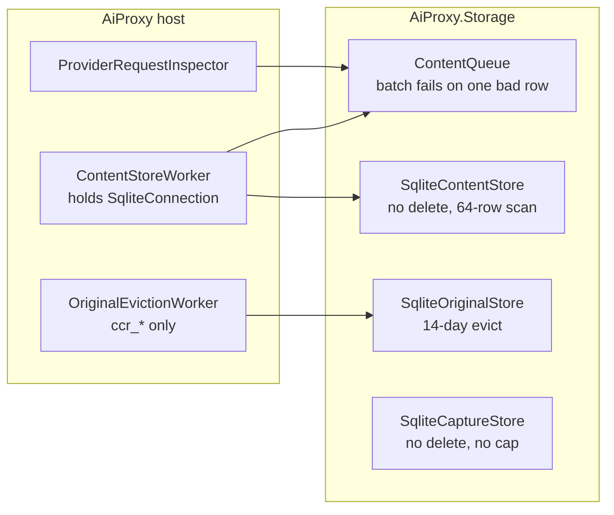
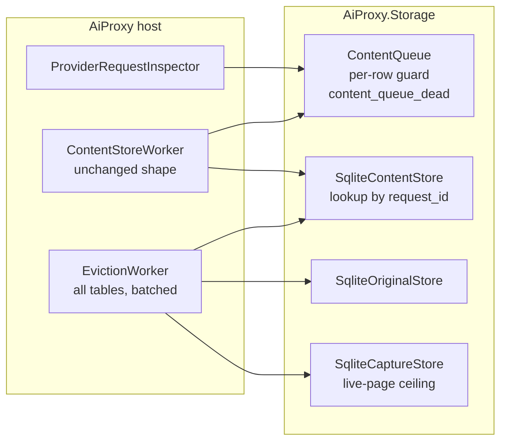

# Plan: act on the project-scope review

Date: 2026-10-30. Source record: [2026-10-30-project-scope-review.md](2026-10-30-project-scope-review.md)
(audited). Campaign branch `review/project-scope-2026-10-30`, draft PR #90. Base: main at
`d6b79dd` (0.17.3). Status: revision 2; wave 1 merged (0.18.0), waves 2 to 4 pending.

F1 already shipped as hotfix 0.17.3 (#89). This plan covers the remaining 29 findings.

## What revision 2 changed

Two independent Opus reviews read revision 1 against the code. They agreed on three points
without seeing each other's work (marked ★).

| # | Revision 1 said | Revision 2 says | Source |
|---|---|---|---|
| C1 | A schema ladder for content, capture and gain, because `Ensure` returns early at v2 so a new index "would never be created" | Bump content `SchemaVersion` to 3. `Ensure` re-runs every statement when the version rises (`ContentSchema.cs:75`), so the index claim was wrong. Capture already runs `CREATE IF NOT EXISTS` once per process, so add indexes there. Gain is untouched. F11 still holds for columns, and nothing here adds a column. | architect P7; orchestrator verified |
| C2 | Capture stops above 1 GB measured by file size | Measure live pages, `(page_count − freelist_count) × page_size`. A DELETE never shrinks the file, and capture.db is already 986 MB, so a file-size ceiling would stop capture for good. Make the ceiling configurable, delete in batches, and run retention before enforcing the ceiling. | architect P8, audit WP1.2 |
| C3 | Retention over a hand-written table list | Derive the list from `sqlite_master`: each table is evicted or on an explicit exempt list. `content_chunk` has no `created_at`, so it is evicted through its parent row. | audit G4 |
| C4 | Poison-row gate: a valid record behind a bad one is persisted | Also assert: queue empty, one dead-letter row with the error, the null row gone, and job 65 found by `request_id`. | audit G5 |
| C5 | WP1 step 4 moves the drain into Storage, gated by WP7's namespace test | Deferred; F18 recorded as accepted for now. That test cannot see `Hosting`, and the move is not needed for any fix. ★ | architect P9, audit G2 |
| C6 | WP2 gate: `bogus` must not reach `ProxyInstance.RunAsync` | Extract `EntryPoint.Route(args)` returning Guard, Command, Serve or Usage, and test it per case. A subprocess test would depend on whether ai-proxy is running on the machine. Unknown-key test uses in-memory configuration. The strict check runs after the guard dispatch and the `--restart` strip. A bare flag is one that trails, or is followed by another flag. | audit G6, architect P12 |
| C7 | WP3 deadline, no clock named | A `TimeProvider`-based cancellation plus `FakeTimeProvider`. Release is observed through the fake upstream's `RequestAborted`. | audit WP3 |
| C8 | WP5: exact-host constraints derived at build time; `ca remove-stale` untrusts Titanium-named roots; gate is a handshake outside the catalog | Constrain to registrable parents (`anthropic.com`, `openai.com`, `googleapis.com`, `openrouter.ai`) read at runtime from an injected host source, and exclude all IP subtrees. Set `DisableWildCardCertificates = true` (Titanium mints `*.anthropic.com` by default). Generate the root with `CertificateRequest` before Titanium's `CreateRootCertificate`, which would otherwise overwrite the pfx on a load failure. A one-time migration removes only the old ai-proxy root, by thumbprint. The command is gone: matching by CN would untrust other Titanium tools' roots. The gate builds chains, positive and negative, instead of a handshake that already fails today. ★ | architect P1-P5, audit G3 |
| C9 | WP5 in wave 2 with others | Ships alone, as its own release, with "restart every harness session after upgrading": `NODE_EXTRA_CA_CERTS` is read once, at client start. Adds an upgrade-from-old-pfx gate. | architect P6 |
| C10 | WP7: production decrypt gate calls `ProviderHostCatalog.ShouldInspectHttps` | Delete the dead helpers and their tests. Routing production through the static catalog would remove the `IProviderHosts` seam that loopback inspection tests use. Moved into WP5. ★ | architect P10, audit G1 |
| C11 | WP7 mutants named M5, M6, M10, M11 | Each mutant defined by path:line and edit (below). | audit G7 |
| C12 | WP7 marker tests onto `FakeTimeProvider` | Release the holder after the first failed `Acquire`, then advance the fake clock. A real `Task.Delay` under a fake clock hangs. | audit WP7 |
| C13 | WP9 has no real gate | An analyzer in `AiProxy.Generators`: `ThrowIfNull` on a non-nullable reference is an error, watched red on the 35 sites. Classic constructors stay review-only. | audit G8 |
| C14 | WP6 extends `CODE_REGEX` with three paths | Invert it: list the paths that skip tests (docs-only); everything else runs them. | audit WP6 |
| C15 | Serialisation list named four files | Adds `ProxyInstance.cs` and `ProxyServiceExtensions.cs:33` (both bind `ProxySettings`, WP2), `ProxyLease.cs`, `CcrRelay.cs` (WP3, WP8), `ProviderRequestInspector.cs` (WP8), `RestartTests.cs` (WP2, WP5, WP7) and `HttpsInspectionTests.cs` (WP5). | architect P11 |

Rejected or not adopted:
- The gate audit offered a dedicated SQLite-in-host test as the alternative to deferring C5.
  Deferring is simpler, and F18 has no failure attached to it.
- The architect's note that a generated pfx password beside a 0600 file "adds little" is accepted
  as a statement for the ADR, not a reason to skip R2's password. An empty password is what lets any
  same-user tool open the key without reading a second file.

## Owner rulings (2026-10-30)

| # | Question | Ruling |
|---|---|---|
| R1 | Retention (F3, F4) | 14 days for content and capture; capture also stops at a byte ceiling. |
| R2 | Root CA (F8) | Name-constrained CA, `ai-proxy` CN, non-empty password, cleanup of the old root. One re-trust. |
| R3 | ADR 0005 (F12) | Supersede: CCR on for every kind; the per-kind gate is withdrawn. |
| R4 | Strictness (F2, F15) | Unknown command or bare flag exits 2 with usage; `--version`; unknown `Proxy:*` keys fail startup. |
| R5 | Non-model traffic in gain (WP8 finding, 2026-10-30) | Savings totals count only model requests; telemetry and other provider-host calls are a separate "other traffic" count, so nothing disappears silently. Implemented as WP10, before WP9. |

## Decisions taken without the owner (reversible)

| # | Decision | Reason |
|---|---|---|
| D1 | A poison queue row moves to `content_queue_dead` with its error. | Halting loses later writes; dropping loses evidence. |
| D2 | Enforce ADR 0006 at namespace level, scanning method bodies, not only signatures. | The ADR's claim is worth keeping. |
| D3 | Gain shows net and percentage beside gross; "Unavailable" flags stay parseable but leave the help. | Keeps rtk compatibility. |
| D4 | `build-bdd` runs the docs, anchor, pin and changelog gates. | Keeps the required-check name meaningful without a ruleset change. |
| D5 | Folder rename (F25) deferred. | Touches every file the packages edit. |
| D6 | Shared multi-user host (F27) out of scope. | Single-user tool. |
| D7 | Log/shell classification (F17): measure on organic traffic after WP4. | Changing it now would tune on review traffic. |
| D8 | WP1 step 4 (F18) deferred. | See C5. |
| D9 | `Proxy:RootCertificatePassword`, when set, wins over the generated password. | Existing configuration keeps working. |

## Work packages

Every acceptance criterion names a test watched red against the unfixed code before the fix.
No gate uses wall-clock time.

### WP1 — Storage retention and queue robustness (F3, F4, F10, F11 part, F29 part)

1. Content `SchemaVersion` 3: `created_at` index on `content_request`, the `content_queue_dead`
   table. Capture gets `captured_at` indexes in its per-process schema.
   *Gate:* a fixture builds a v2 file from a copy of the v2 statements kept in the test. After
   `Ensure` the index exists (red today). A second `Ensure` on v3 does not write (`data_version`
   unchanged).
2. Retention: one pass, 14 days (`SqliteOriginalStore.Retention` shared), in batches. Chunks go with
   their parent request. content.db is created 0600.
   *Gates:*
   - fake-clock rows at 13 and 15 days, per table;
   - a schema test that every table in `sqlite_master` is evicted or explicitly exempt (red when a
     new table is added without a decision);
   - a 0600 test (Unix).
3. Capture ceiling: configurable, measured in live pages; capture stops and logs once above it,
   and resumes after eviction frees pages.
   *Gates:* a small configured ceiling refuses a write; one eviction pass over old rows resumes
   capture.
4. Queue: per-row deserialise guard into `content_queue_dead`; a null row is deleted; pending
   lookup by `request_id`.
   *Gate:* a malformed payload ahead of a valid one; after one pass the valid record is persisted,
   the queue is empty, the dead-letter table has one row with the error, the null row is gone, and a
   pending job at position 65 is served. Red today.

### WP2 — CLI and configuration strictness (F2, F15, F20, F26 part)

- `EntryPoint.Route(args)` → Guard, Command, Serve or Usage; `Program.cs` switches on it.
- The strict check runs after the guard dispatch and the `--restart` strip.
- `--version` prints VERSION.
- Unknown `Proxy:*` keys fail startup, naming the key, in both binding sites.
- The second-instance message carries the pid, the port and `--restart`.
- `mcp --endpoint` loses the `(Parameter 'endpoint')` suffix and checks reachability.
- The changelog says a stray `PROXY__*` environment variable now stops startup.

*Gates:*
- `Route` cases: `bogus` and a trailing `--flag` give Usage (red today); the guard argument vector
  gives Guard; `--restart` with `--Proxy:Port 8090` gives Serve.
- In-memory configuration with `Proxy:Prot` fails.
- Existing `RestartTests` cases that pass invalid config values still behave as before.

### WP3 — CCR relay hardening (F7, F22, F23 relay part)

- The first send is linked to the session token and has a headers deadline on the injected
  `TimeProvider`.
- `AllowAutoRedirect = false`.
- Arguments come from `CcrRetrievalParser`.

*Gates:*
- A stub that never sends headers fails once `FakeTimeProvider` passes the deadline.
- A client cancel sets the stub's `RequestAborted` (observed through a TaskCompletionSource).
- A 307 stub reaches the client, and the redirect target's hit count stays 0.
Each is red today.

### WP4 — Compression pipeline correctness (F9, F30, shared-reducer coverage)

- `MessagesApi.Json` for rewritten regions.
- `JsonCompressionHandler` falls back to the line rule on the writer's exception.
- Per-caller tests pinning the 0.17.3 adjacent-repeat rule for log, shell transcript and the
  JSON/XML fallbacks.

*Gates:*
- `< & ' é` are forwarded unescaped.
- The lone-surrogate fixture yields path `json.dedupe` and the expected text.
Both are red today.

### WP5 — Root CA (F8, F23 helper part), its own release

- The root is generated in ai-proxy with `CertificateRequest`:
  - permitted DNS subtrees for the registrable parents of the injected host source's names;
  - excluded IPv4 and IPv6 subtrees;
  - CN `ai-proxy local inspection CA`;
  - a random pfx password stored 0600 unless `Proxy:RootCertificatePassword` is set.
- It is assigned before `CreateRootCertificate`.
- `DisableWildCardCertificates = true`.
- Migration: read the old pfx's thumbprint with the old password, create and trust the new root,
  untrust only that thumbprint, and log "restart every ai-proxy harness session".
- Delete `ShouldInspectHttps*` and their tests.

*Gates:*
- A leaf for `api.anthropic.com` minted by the CA chain-builds.
- A leaf for `evil.example` fails with `HasNotPermittedNameConstraint` (red today: there is no
  constraint).
- The stored password opens the pfx and an empty one does not.
- Starting against a data directory holding an old empty-password pfx produces a new pem and records
  the old thumbprint for removal.
- `HttpsInspectionTests` (loopback through the injected source) stays green.
- CI runs the chain tests on Linux and macOS.

### WP6 — Docs, ADRs and CI (F12, F14, F21, F19 ADR figure)

- ADR 0008 supersedes ADR 0005's configuration and activation-gate sections, names what it
  supersedes, and corrects the tool cost (about 222 estimated tokens).
- ADR 0001 amended to the Titanium shape; 0001 and 0002 set to Accepted. ADR 0006 notes D2.
- README port set to 8080; anchors re-pointed.
- `scripts/check-evidence-anchors.py`.
- `build.yml` lists the paths that skip tests instead of the paths that run them.
- `build-bdd` runs the docs-index, anchor, pin and changelog gates (D4).
- `release.yml` requires `docs/changelog/${VERSION}-*.md`.
- RELEASING.md documents the automatic tag and release.

*Gates:*
- The anchor script fails on today's dead anchors.
- The changelog check fails on a scratch VERSION with no entry.
- A change touching only `global.json` triggers tests.

### WP7 — Test gates (F5, F6, F13, F28)

- Remove the `RestartTests.cs:328` skip.
- `UpstreamDropTests`: drop the Stopwatch assertion and unskip.
- Marker tests on `FakeTimeProvider` (C12), unskipped.
- ADR 0006 test scanning method-body references in `AiProxy.Mcp`/`Cli`/`Client` for
  `AiProxy.Storage` and `Microsoft.Data.Sqlite`.
- Isolate the F28 flake.

*Gates*, each mutant killed after the package and surviving at base:

| Mutant | Edit |
|---|---|
| M5 | `src/AiProxy/Hosting/Proxy/ProxyControl.cs:149`: replace `owner.Product != "ai-proxy" \|\|` with `false \|\|` |
| M6 | `ProxyControl.cs:141`: replace `processIdentity.StartToken != owner.ProcessStartToken \|\|` with `false \|\|` |
| M10 | `src/AiProxy/Hosting/Marker/SystemProxyMarker.cs`, `Acquire`: deadline test becomes `>= deadline \|\| wait > TimeSpan.Zero` |
| M11 | `src/AiProxy/Hosting/Integration/TitaniumProxyService.cs:345`: delete `e.TerminateSession();` |
| M12 | `src/AiProxy/Mcp/RetrievalTools.cs`: a local `new SqliteGainStore(...)` in a method body |

### WP8 — Gain reporting (F19, F26, D3)

- First, check whether the 10-26 gap (only `unchanged` rows) is a recording defect.
- Net and percentage columns.
- A `ccr.tool` rule.
- An empty-project hint.
- Help hides the "Unavailable" flags and describes every flag.
- Thousands separators.

*Gates:*
- The tool-only row is recorded as `ccr.tool` (red today).
- A ledger with both retrieved and tool greater than 0 pins the net sign.

### WP9 — Invariant hygiene (F24)

- Delete the 35 redundant `ThrowIfNull`.
- Convert the 5 classic constructors.
- `ProxyLease` becomes an instance.

*Gate:* the C13 analyzer, red on today's sites.

## Sequencing

| Wave | Packages | Why |
|---|---|---|
| 1 | WP1, WP2, WP3, WP4, WP6 | No shared files except the composition root. |
| 2 | WP7, WP8 | WP7 edits `RestartTests.cs` after WP2. WP8 edits `CcrRelay.cs` after WP3 and the gain CLI after WP2. |
| 3 | WP9 | Touches files every package edited; the analyzer would otherwise fail other branches. |
| 4 | WP5, own release | Re-trust and harness restarts; isolated so a TLS regression has one cause. |

Serialisation points:

| File | Packages |
|---|---|
| `ProxyServiceExtensions.cs` | WP1, WP2, WP3, WP5 |
| `ProxyInstance.cs` | WP2, WP9 |
| `ProxyLease.cs` | WP2, WP9 |
| `CliApplication.cs` | WP2, WP8 |
| `CcrRelay.cs` | WP3, WP8 |
| `ProviderRequestInspector.cs` | WP8 |
| `TitaniumProxyService.cs` | WP5, WP7, WP9 |
| `RestartTests.cs` | WP2, WP5, WP7 |
| `HttpsInspectionTests.cs` | WP5 |
| `ContentSchema.cs`, `SqliteContentStore.cs` | WP1 only |

Measurement chain: F16 (organic retrieval rate) and D7 are measured after wave 1, on a normal
working week, excluding review traffic by date. Measuring before WP4 would count escape bloat as
reducer output.

Must ship together: content retention deletes the originals that `GET /content/{id}` serves.
That is acceptable because MCP retrieval reads `ccr_original` (`GainEndpoints.cs:29-40`,
`SqliteOriginalStore.cs:33`), which has the same 14 days.

Release: wave 1 to 3 ship as 0.18.0 (one VERSION bump on the campaign branch, one changelog
entry amended per wave). WP5 ships as 0.19.0.

## Module shape, before and after (storage)

Before (verified at `d6b79dd`):

After (WP1; the drain stays in the host, D8):

## Wave 1 outcome (2026-10-30)

All five packages merged into the campaign branch as 0.18.0 (`be3621a`). Every gate was watched red
before green. Where a lane wrote code before its test, the orchestrator watched the gate red by
mutating the code back afterwards: WP2's second-instance message and MCP suffix, and WP1's
no-write `Ensure`. The suite went from 920 to 974 passed, 0 failed, 7 skipped, and each merge
re-ran the build and full suite on the merged tree.

Deviations from the plan:

- **WP3 gate (b) is not met.** Titanium 7.0.26 exposes no public client or session
  cancellation token before `RespondStreaming` (CS1061 on `SessionEventArgs.CancellationToken`). A
  client that disconnects while the upstream is silent holds the request until the 10-minute headers
  deadline. Accepted as a limitation; no reflection on Titanium internals.
- **WP2's MCP reachability check is a stderr warning, not a failure.** MCP clients spawn the server
  before the proxy starts.
- **WP6 was implemented by the orchestrator.** Its lane's auto-worktree was cleaned up before the
  correction reached it.

Join defects found at merge:

- **WP2 × WP6.** WP2 moved the restart `catch` in `ProxyInstanceLifetime.cs` from line 32 to 40.
  WP6's two `:32` evidence anchors then pointed at the wrong code, and
  `check-evidence-anchors.py` stayed green, because it checks that the line exists, not what it
  says. Re-pointed in the merge commit. The gate's weakness is carried into wave 2 (WP7).
- **WP6 alone.** Inlining the action-pin grep in `build-bdd` made the pin gate match its own
  pattern text. Fixed by one shared `scripts/check-action-pins.sh`.

Added to WP7 for wave 2: evidence anchors carry the expected text (or a symbol name) and the check
compares it, so a shifted line fails. Watch it red on a deliberately shifted anchor.

## Waves 2 to 4 outcome (2026-10-30)

Waves 1 and 2 and WP10 shipped as 0.18.0 (#90). The owner's ruling R5 added WP10 between waves 2
and 3. Waves 3 and 4 shipped as separate releases, because 0.18.0 had merged before WP9 finished:

- **WP9, 0.18.1 (#91).** The analyzer rule APGEN003 failed the build on 36 sites, and they are
  now deleted. Re-adding `ThrowIfNull(part)` in `ContentRouter.Route` fails the build again.
- **WP5, 0.19.0 (#93; #92 was its stacked predecessor).** With the name-constraint extension removed, 9 of the 19
  certificate tests fail. ADR 0009 records the decision and what it supersedes in ADR 0003.

Join defect at the WP5 × WP9 merge: WP9 made `TimeProvider` required, and WP5's new
`RootCertificateStorageTests` helper did not pass one. It failed with CS7036 on the merged tree
only.

Deviations from the plan:

- **WP5:** macOS reports `InvalidNameConstraints`, not `HasNotPermittedNameConstraint`, so the
  negative test asserts the flag per OS.
- **WP5:** an address family that the host source names permits exactly those addresses. Only
  loopback test sources name addresses. Production excludes all IP space, as planned.
- **WP5:** `IProviderHosts` gained `Hosts`, because the constraint needs the full host list.
- **WP9:** the MCP inventory generator emits nothing for a project with no tools. Without this,
  the analyzer reference caused CS0433.

## Still open

- F16 and D7: measure the organic retrieval rate and the log/shell classification on a normal
  working week, excluding review traffic by date.
- WP5 on Linux: the chain test's `HasNotPermittedNameConstraint` expectation runs first in CI.
  NSS databases are not cleaned of the old root.
- WP5: no macOS CI job runs the certificate tests. Proposed: an OS matrix in `build.yml` for those
  classes.
- WP5: a constrained root is not rotated when a new provider domain is added.
- Test port race: resolved 2026-10-31. The integration helpers bind port 0 and read the bound port
  from `TitaniumProxyService.Address`.
- Titanium `ConnectionTimeOutSeconds` and long silent generations: not planned until measured.
- Agent worktrees: a hook refuses git in subagents. The orchestrator commits for them (owner
  ruling, 2026-10-30).
