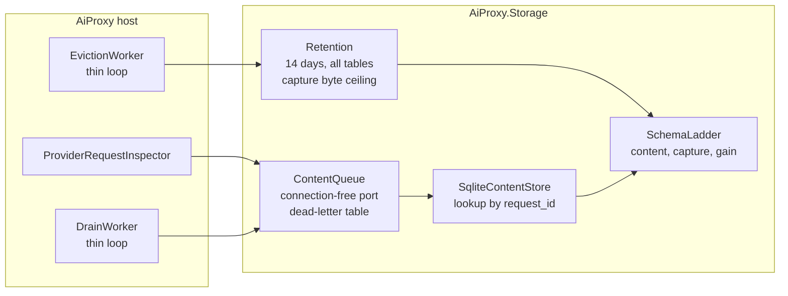

# Plan: act on the project-scope review

Date: 2026-10-30. Source record: [2026-10-30-project-scope-review.md](2026-10-30-project-scope-review.md)
(audited). Campaign branch `review/project-scope-2026-10-30`, draft PR #90. Base: main at
`d6b79dd` (0.17.3). Status: draft, before the architect and adversarial plan reviews.

F1 already shipped as hotfix 0.17.3 (#89). This plan covers the remaining 29 findings.

## Owner rulings (2026-10-30)

| # | Question | Ruling |
|---|---|---|
| R1 | Retention (F3, F4) | 14 days for `content_request`/`content_chunk` and capture; capture also stops at a byte ceiling. |
| R2 | Root CA (F8) | New CA: permitted-DNS name constraints for the provider hosts, an `ai-proxy` CN, a non-empty generated password, and a cleanup path for old roots. One re-trust on upgrade. |
| R3 | ADR 0005 (F12) | Supersede: CCR on for every kind. The per-kind gate is withdrawn. |
| R4 | Strictness (F2, F15) | Unknown command or bare flag exits 2 with usage; add `--version`; unknown `Proxy:*` keys fail startup and name the key. |

## Decisions taken without the owner (reversible)

| # | Question | Decision | Reason |
|---|---|---|---|
| D1 | Poison queue row (F10) | Move it to a `content_queue_dead` table with the error, then continue. | Halting loses every later write. Dropping loses the evidence. |
| D2 | ADR 0006 boundary (F13) | Enforce at namespace level with a test. | It is cheap, and the ADR's claim is worth keeping. |
| D3 | Gain headline (F19, F26) | Show net (saved − retrieved − tool) and a percentage beside gross. Hide "Unavailable" flags from help but keep them parsing. | rtk compatibility stays; the help stops advertising dead flags. |
| D4 | `build-bdd` (F21) | Retarget it to run the docs, anchor and changelog gates instead of a third identical suite. | The required-check name stays meaningful without a ruleset change. |
| D5 | Folder rename (F25) | Deferred. | It touches every file the other packages edit, and its severity is LOW. |
| D6 | Shared multi-user host (F27) | Out of scope; recorded. | Single-user tool. |
| D7 | Log/shell classification (F17) | Investigate only: measure on organic traffic after WP5 before changing classification. | Changing it now would be tuned on review traffic. |

## Work packages

Each package is one branch, merged into the campaign branch. Every acceptance criterion has a
named test, and each test is watched red against the unfixed code before the fix.

### WP1 — Storage: schema ladder, retention, queue robustness (F3, F4, F10, F11, F18, F29 part)

Order inside the package is fixed: the ladder lands first. On existing databases,
`ContentSchema.Ensure` returns early at `user_version >= 2` (`ContentSchema.cs:75`). So any index or
column that retention needs would never be created, and retention would silently run without it.

1. Ladder: `user_version` steps for content, capture and gain; each step runs once, in order; an
   existing v2 content.db upgrades to v3.
   *Gate:* a test opens a v2 database built by the old statements and asserts the new index exists
   after `Ensure`. Watched red against the current early return.
2. Retention: one eviction pass over `ccr_original`, `ccr_thread`, `content_request`,
   `content_chunk` and `capture_request`/`capture_response` at 14 days (`SqliteOriginalStore.Retention`
   becomes the shared constant). Capture stops writing above a byte ceiling (default 1 GB, logged once).
   Index `created_at`/`captured_at`. content.db created 0600.
   *Gate:* fake-clock tests per table, rows at 13 and 15 days, and a capture test at the ceiling.
   Each is watched red with the delete removed.
3. Queue: a per-row deserialise guard moves a poison row to `content_queue_dead` (D1). A null row is
   deleted. Pending lookup is by `request_id`, not a 64-row scan.
   *Gate:* enqueue a malformed payload ahead of a valid one; the valid record is persisted within
   one pass. Red against current code.
4. Move the drain pass into `AiProxy.Storage` behind a connection-free `IContentQueue` (F18). The
   host keeps a thin `BackgroundService`.
   *Gate:* the F13 namespace test (WP7) proves the host has no `Microsoft.Data.Sqlite` usage outside
   the composition root.

### WP2 — CLI and configuration strictness (F2, F15, F20, F26 part)

- An unknown first token or bare flag exits 2 with usage. `--restart`, `--key=value` and `--key value`
  configuration forms still pass. `--version` prints VERSION.
- Unknown `Proxy:*` keys fail startup and name the key (`ErrorOnUnknownConfiguration`).
- A second instance prints "ai-proxy is already running (pid N, port P). Use `ai-proxy --restart`
  to replace it."
- `mcp --endpoint` drops the `(Parameter 'endpoint')` suffix and checks reachability like `harness`.
*Gates:* a CLI test per case. `ai-proxy bogus` must not reach `ProxyInstance.RunAsync`, and that test
is watched red today. `PROXY__PROT` fails.

### WP3 — CCR relay hardening (F7, F22, F23 relay part)

- The first upstream send uses the session token and a headers deadline.
- `AllowAutoRedirect = false`.
- Retrieval arguments come from `CcrRetrievalParser`, with no second parse.
*Gates:* a stub upstream that never sends headers fails within the deadline; a client cancel
releases the upstream; a 307 stub is returned to the client, not followed. Each is watched red.

### WP4 — Compression pipeline correctness (F9, F30, shared-reducer coverage)

- Serialise rewritten regions with `MessagesApi.Json`.
- `JsonCompressionHandler` falls back to the line rule on the writer's exception.
- Add per-caller tests pinning the 0.17.3 adjacent-repeat rule for log, shell transcript, and the
  JSON/XML fallbacks.
*Gates:* a region containing `<`, `&`, `'`, `é` is forwarded unescaped (red today); a lone-surrogate
JSON fixture yields `json.dedupe`, not `compression.handler-failed` (red today).

### WP5 — Root CA (F8, R2)

- Generate the CA with name constraints (permitted DNS = `ProviderHostCatalog` hosts, derived at
  build time, not a second list), CN `ai-proxy local inspection CA`, and a generated random pfx
  password kept beside the key with mode 0600.
- On first start after upgrade, regenerate once and log the re-trust instruction.
- `ai-proxy ca remove-stale` lists and untrusts Titanium-named roots that do not match the current key.
*Gates:* a test parses the generated certificate and asserts the name constraints equal the
catalog's hosts (derived); opening the pfx with an empty password fails; a TLS handshake for a host
outside the catalog fails against a leaf minted by this CA.
*Risk:* a provider host missing from the catalog is then refused. The catalog is already the
decrypt allow-list, so decryption and the constraint cannot diverge.

### WP6 — Docs, ADRs and CI (F12, F14, F21, F19 ADR figure)

- New ADR 0008 superseding ADR 0005's configuration and activation-gate sections (R3), naming
  what it supersedes and correcting the tool cost (about 222 estimated tokens, not 147).
- ADR 0001 amended to the Titanium shape; 0001 and 0002 set to Accepted.
- README port restored to 8080; evidence anchors re-pointed.
- `scripts/check-evidence-anchors.py`: every `evidence=path:line` resolves to an existing file and
  an in-range line.
- CI: `CODE_REGEX` adds `scripts/CodeReducerCore/`, `global.json` and `Directory.Build.targets`.
  `build-bdd` runs the docs-index, anchor, pin and changelog-exists gates (D4). `release.yml` checks
  that `docs/changelog/${VERSION}-*.md` exists. RELEASING.md documents the automatic tag and release.
*Gates:* the anchor script fails on the current four dead anchors (red), then passes. The changelog
check fails on a scratch VERSION with no entry.

### WP7 — Test gates (F5, F6, F13, F23 dead helper, F28)

- Remove the `RestartTests.cs:328` skip.
- `UpstreamDropTests`: delete the Stopwatch assertion and unskip.
- Move `SystemProxyMarkerTests.cs:39` and `TitaniumProxyServiceTests.cs:217` to `FakeTimeProvider`
  and unskip.
- ADR 0006 namespace test: no type in `AiProxy.Mcp`, `AiProxy.Cli` or `AiProxy.Client` namespaces
  references `AiProxy.Storage` or `Microsoft.Data.Sqlite`.
- Production decrypt gate calls `ProviderHostCatalog.ShouldInspectHttps` (one copy).
- Isolate the F28 flake.
*Gates:* re-run QA mutants M5, M6, M10 and M11. Each must now be killed (it survived at base). The
namespace test goes red with a `SqliteGainStore` in `RetrievalTools`.

### WP8 — Gain reporting (F19, F26, D3)

- Net and percentage columns.
- `ccr.tool` rule for tool-only changes (the 642-byte rows).
- Empty-project hint naming `X-Ai-Proxy-Project` and `harness`.
- Hide "Unavailable" flags from help.
- Describe every flag.
- Thousands separators.
*Gates:* report tests on fixed ledgers; the tool-only row is recorded as `ccr.tool` (red today).

### WP9 — Invariant hygiene (F24, F10 static-class part)

- Remove the 35 redundant `ThrowIfNull`.
- Convert the 5 classic constructors.
- Make `ProxyLease` an instance.
*Gate:* a grep-based test that fails on `ThrowIfNull(` against a non-nullable parameter is not
practical; the gate is the deletion grep naming each site, run in CI once, plus the build and full
suite.

## Sequencing

| Wave | Packages | Why this order |
|---|---|---|
| 1 | WP1, WP2, WP3, WP4, WP6 | No shared files except the composition root (below). |
| 2 | WP5, WP7, WP8 | WP5 adds a CLI command (after WP2's parser) and edits `TitaniumProxyService.cs`. WP7's decrypt-gate change edits the same file, so it lands after WP5. WP8 edits gain CLI files after WP2. |
| 3 | WP9 | Touches files every other package edited. |

Serialisation points:
- `src/AiProxy/ProxyServiceExtensions.cs` (WP1 worker, WP3, WP5). Each package adds lines in
  its own `Add*` method; merges resolve by keeping both.
- `src/AiProxy/Cli/CliApplication.cs` (WP2, WP5, WP8).
- `src/AiProxy/Hosting/Integration/TitaniumProxyService.cs` (WP5, WP7, WP9).
- `ContentSchema.cs` / `SqliteContentStore.cs` (WP1 only, ordered inside it).

Measurement chain: F16 (organic retrieval rate) and D7 (log classification) are measured after
wave 1 ships, on a normal working week, with the review's own traffic excluded by date. Measuring
before WP4 would count escape bloat as reducer output.

Must ship together: WP1's retention deletes `content_request` originals that `GET /content/{id}`
serves. That is acceptable only because `ccr_original` (what retrieval actually uses) already has the
same 14 days. WP1 must not shorten one without the other.

Release: VERSION 0.18.0, bumped once on the campaign branch, with one changelog entry amended per
wave.

## Module shape, before and after (storage and host drain)

Before (verified at `d6b79dd`):

```mermaid
flowchart LR
  subgraph Host[AiProxy host]
    PRI[ProviderRequestInspector]
    CSW[ContentStoreWorker<br/>holds SqliteConnection]
    OEW[OriginalEvictionWorker<br/>ccr_* only]
  end
  subgraph Storage[AiProxy.Storage]
    CQ[ContentQueue<br/>IContentQueue takes SqliteConnection]
    SCS[SqliteContentStore<br/>no delete, 64-row scan]
    SOS[SqliteOriginalStore<br/>14-day evict]
    CAP[SqliteCaptureStore<br/>no delete, no version]
    SCH[ContentSchema<br/>early return at v2]
  end
  PRI --> CQ
  CSW --> CQ
  CSW -. Microsoft.Data.Sqlite .-> SCH
  CSW --> SCS
  OEW --> SOS
```

After:



## Still open

- Whether the 10-26 gain gap (only `unchanged` rows) is a recording defect; WP8 checks it first.
- Titanium `ConnectionTimeOutSeconds` and long silent generations: not in any package until measured.
- Cross-OS unit runners for marker, registrar and guard (QA F6): not planned; RestartTests stays
  the only cross-OS check.
