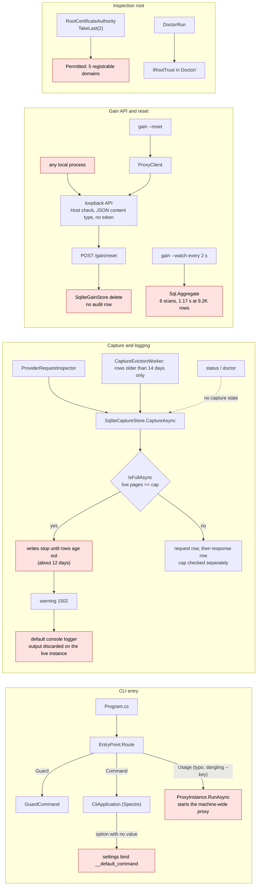
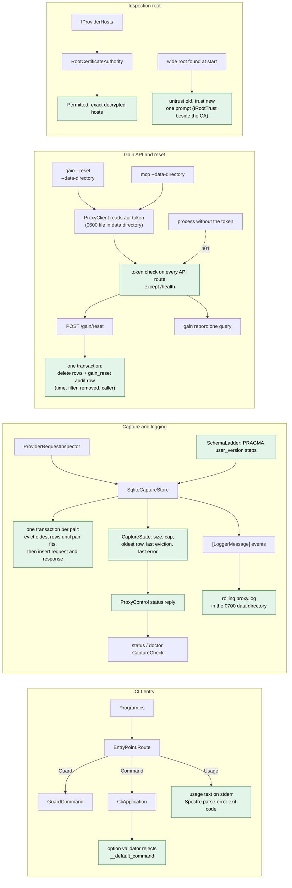
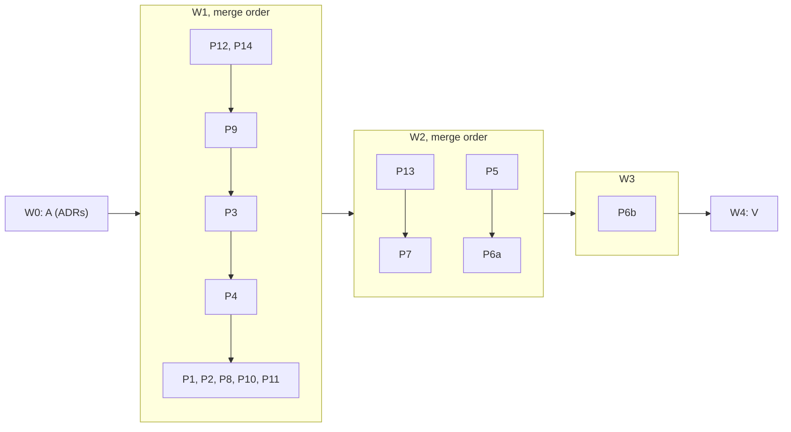

# Plan: Fix the 0.34.0 project-scope review findings

**Date:** 2026-11-21 (Revision 1 the same day)
**Input:** [2026-11-21-project-review.md](2026-11-21-project-review.md) at base `9d9c5b4` (0.34.0). Where the adversarial verification table corrected a number, this plan uses the corrected one.
**Owner rulings (2026-11-21):** fix every HIGH and MEDIUM finding (F1, F2, F3, F30, F31, F25, F4, F5, F6, F8, F9, F11, F13, F14, F15, F16, F17, F18, F19, F26, F27). F7 is LOW. Each LOW or NIT finding gets a characterization test that names it as not endorsed, or one line in the Deferred table. F5 narrows the root to exact hosts and rotates it once. F4 adds a reset audit row and a loopback API token. F25 adds a rolling log file and capture state in `status` and `doctor`. F3 and F30 keep capture running at its cap by evicting the oldest rows by bytes. The rulings on the plan's own questions are at the end, under "Owner rulings on the plan's questions".

## Revision 1 (2026-11-21): what changed and why

Two reviews read the first draft: a gate audit (every gate checked for honesty and feasibility) and a sequencing review (file ownership, waves, scope). The orchestrator settled four points they left open. Every row below names its source. Code citations from the reviews were re-checked at the worktree before use.

| # | Source | What changed | Package |
|---|---|---|---|
| 1 | Gate audit (P1) | Port-free gate replaced. The child asserts Spectre's parse-error exit code read from `CommandApp`, usage text and the bad token on stderr, and no `proxy.pid` or lock file in HOME. | P1 |
| 2 | Sequencing review (NIT 11) | P1 effort S to M: five settings files, EntryPoint, Program, a process test, and a removed exit code. | P1 |
| 3 | Gate audit (P2) | "Live-shape rows" named: `235.4M`, `-12.3M`, `100.0%`, three harness host labels, Width=80 set on the console profile. | P2 |
| 4 | Gate audit (P3) | Gate no longer depends on EventId 1502, which P4 deletes. It asserts the start event (1301, "AI proxy listening") in `proxy.log`, plus a 0600 mode unit test and a console-unchanged check. | P3 |
| 5 | Sequencing review (NIT 9) | The log file decision leaves ADR 0019 and becomes ADR 0020. | A, P3 |
| 6 | Gate audit (P4) | Four gates added: pair atomicity under a thrown insert, `CaptureState` after that failure, a pair bigger than the cap, the 14-day prune below the cap. | P4 |
| 7 | Sequencing review (SHOULD 6) | `CaptureEvictionWorker.cs` added to P4. P4 may not edit the capture registration in `ProxyServiceExtensions.cs`; P12 owns that file in W1 and merges first. | P4, P12 |
| 8 | Gate audit (P5) | Byte gate rebuilt: the delete returns a row count, so a test hook sums `length(body)` over each batch's rowid set before the delete. A content.db ladder gate added. | P5 |
| 9 | Orchestrator decision (2), sequencing review (SHOULD 4) | P6 split. P6a: gain ladder, reset audit row, one-pass report. P6b: API token on every route except `/health`, all clients, test helpers, token discovery. | P6a, P6b |
| 10 | Gate audit (P6) | Report gate is a command-count gate (one query) with output equal to 0.34.0 on a seeded store. Timing goes in the changelog draft as an observation only. | P6a |
| 11 | Gate audit (P6) | The 401 gate takes its route list from `EndpointDataSource`. Gates added for the token rewrite at start, 0600 mode, the caller field and each client sending the token. | P6a, P6b |
| 12 | Sequencing review (MUST 2), orchestrator decision (2) | Token discovery for a non-default data directory: a `--data-directory` option on `gain`, `mcp` and `replay` (replay keeps `--home` as is, see rejections). Recorded in ADR 0018. `/health` is exempt and gets a gate. `GainSettings.cs`, `McpCommand.cs`, `McpServerProcess.cs` join P6b, so P6b waits for P1. | A, P6b |
| 13 | Sequencing review (MUST 1) | `DoctorRun.cs` is shared by P6b (HttpClient built at `DoctorRun.cs:21-23`), P7 (`new SystemRootTrust()` at `:34`) and P13. Order: P13, then P7 in W2, then P6b in W3. | P6b, P7, P13 |
| 14 | Sequencing review (MUST 1) | `IRootTrust` and `SystemRootTrust` move out of `src/AiProxy/Doctor/` beside `RootCertificateAuthority`, so the start-time rotation does not make `Hosting/Integration` depend on `Doctor/`. | P7 |
| 15 | Gate audit (P7) | Gates added: a root built from the DI-built `IProviderHosts` permits exactly `IProviderHosts.All`, `chatgpt.com` included; after rotation a leaf for `api.anthropic.com` chains to the new thumbprint; `doctor` warns on a wide root. | P7 |
| 16 | Sequencing review (SHOULD 7) | P7 file list gains the five tests that assert the root's shape. `DoctorCommandTests.cs` is serialised: P7 in W2, P6b in W3. | P7, P6b |
| 17 | Gate audit (P10) | `HeadersDeadline` is a static 10 min (`CcrRelay.cs:38`) and the follow-up send (`SendWithPingsAsync`, near `:435`) has none. Gate: advance a `FakeTimeProvider` by `HeadersDeadline` + 1 s, assert one error event, no ping over 3 more keep-alive intervals, stream completed. | P10 |
| 18 | Orchestrator decision (4), sequencing review (NIT 9) | ADR 0020 (relay deadline) becomes an amendment line in ADR 0005. P10 depends on that amendment, not on a new ADR. | A, P10 |
| 19 | Gate audit (P11) | Vacuous same-source gate replaced by literal values (mode enum, context 0..10, minimum 1, `^[0-9a-f]{16}$`) and a ±1 probe of each bound against the API validator. | P11 |
| 20 | Sequencing review (NIT 10) | P12 merges first in W1 with P14, because it owns the shared composition file. | P12 |
| 21 | Gate audit (P13), sequencing review (SHOULD 5) | A round trip through the real `ProxyControl` status reply added. `ProxyInstanceLifetime.cs` (where `ProxyInfo` is built, lines 76-85) joins P13; P6b waits for it. | P13, P6b |
| 22 | Gate audit (P14) | Each F23 test names its mutation: strip `TE` in the pass-through; drop the preview-header guard. | P14 |
| 23 | Orchestrator decision (1), gate audit (P8), sequencing review (SHOULD 8) | P8 uses the lighter check in a script with unit tests taking (VERSION, latest tag, changed paths). The ruleset gate is removed (F27 lanes stay advisory). `lifecycle.yml` gets `cancel-in-progress: ${{ github.ref != 'refs/heads/main' }}`. Reversible. | P8 |
| 24 | Follows from row 23 | P8 changes no `src/` file and no longer blocks or is blocked by code packages, so it moves to W1. The final wave is V alone. | P8, V |
| 25 | Orchestrator decision (3), sequencing review (MUST 3) | Running notes go to `docs/work/2026-11-21-project-review-changelog-draft.md`. `docs/changelog/{version}-*.md` is created only in V. | orchestrator, V |
| 26 | Orchestrator decision (4) | ADR numbers stay contiguous from 0017: 0017 root, 0018 token and audit, 0019 capture eviction and state, 0020 log file, 0021 schema ladder. | A |
| 27 | Gate audit (join tests) | New "Join tests" section: eight cross-package tests, each owned by the later package of its pair. | P4, P6b, P8, P13, P14, V |
| 28 | Gate audit (fixed with no gate) | Every AC listed there now has a gate in its package. | P3, P4, P6a, P6b, P7 |

**Rejected or narrowed review points**

- Sequencing review MUST 2 offered "a token path published by the proxy" as one option. Rejected: the orchestrator chose a `--data-directory` option, which reuses the option `stop`, `status` and `doctor` already have and needs no new discovery file.
- The brief names `--data-directory` on `replay`. Replay already has `--home <DIR>` for the same purpose (`ReplaySettings.cs:47-49`), and F23 defers the rename of that pair. P6b reads the token through `--home` on replay and does not add a second option for one concept. If replay turns out to need no token at all (join test 6 says it opens no store and calls no API), P6b changes nothing there.
- Sequencing review MUST 1 alternative "give DoctorRun.cs to P13 and let P6 and P7 rebase on it": partly taken. P7 rebases on P13 inside W2, but P6b moves to W3, because it also shares `ProxyInstanceLifetime.cs` and `DoctorCommandTests.cs`.
- Orchestrator decision (1) read as one rule: the check acts only on a PR that changes VERSION. A literal reading ("fail when VERSION already has a release tag") would fail every PR that leaves VERSION alone, since VERSION then equals the latest tag.

## How the campaign ships

There is one version bump for the whole campaign, to the next minor version, decided at the release PR (V) by the owner's ruling. Each package is its own PR to `main`. The orchestrator keeps running release notes in `docs/work/2026-11-21-project-review-changelog-draft.md` and amends it at the end of each wave. No lane edits VERSION, the draft, or `docs/changelog/`.

V is the only PR that changes VERSION, and it creates `docs/changelog/{version}-project-review-fixes.md` from the draft. `release.yml` tags `main` the moment VERSION changes, so an earlier bump would cut a release before later waves land. That is the F26 defect, done by the plan itself. Until V merges, nobody dispatches `publish.yml`.

## Current shape

Drawn from the verified facts in the review record. Red nodes are the defects this plan closes.

## Proposed shape

## Decision records before code

ADR numbers continue from 0016 (`docs/adr/README.md`) and stay contiguous. Package A writes them as Draft. The owner accepts each one before the packages that depend on it start.

| ADR | Decision | Amends | Blocks |
|---|---|---|---|
| 0017 | The root's name constraint lists the exact hosts `IProviderHosts` decrypts (provider and harness-only hosts), not their registrable parents. A root whose constraint differs from the current host set is untrusted and replaced at start, with one trust prompt. A new provider host therefore means a new root. The ADR also corrects the 0009 wording about the pfx password: it gives no protection at rest. | 0009 | P7 |
| 0018 | Every loopback API route except `/health` needs a bearer token that the proxy writes at start to a 0600 file in the 0700 data directory. `/health` stays open because `ApiCheck` and `McpServerProcess.IsReachableAsync` probe it before any token is read. A client finds the token through the data directory: the default, `Proxy__DataDirectory`, or a `--data-directory` option on `gain` and `mcp` (`--home` on `replay`). Every gain reset writes a `gain_reset` row (UTC time, filter, removed count, caller) in the same transaction as the delete. | 0006, 0010 | P6a (audit), P6b (token) |
| 0019 | Capture keeps writing at its cap: it evicts the oldest rows by bytes in the transaction that inserts a request and response pair, and the 14-day age prune stays as a second bound. Capture state travels in the control-pipe status reply. | the capture rules of 0012 | P4, P13 |
| 0020 | The proxy writes its log to a rolling `proxy.log` in the data directory (two files, fixed size, 0600, written by a small in-house `ILoggerProvider`). | none | P3 |
| 0021 | Each SQLite store stamps `PRAGMA user_version` and opens through an ordered ladder of steps. A file newer than the code refuses to open. | 0002 | P4, P5, P6a |
| 0005 amendment | One added line: a retrieval follow-up send gets a header deadline. When it expires, the relay ends the turn with an error event instead of sending pings forever. | 0005 relay section | P10 |

## Serialisation points

Each of these files is touched by more than one package. The plan gives each file to one package per wave, or fixes the merge order inside the wave.

| File | Owner package (wave) | Why others wait |
|---|---|---|
| `src/AiProxy/ProxyServiceExtensions.cs` | P12 (W1, merges first), then P6b (W3) | P12 splits `AddCompression`. P6b adds the token check next to `UseMiddleware<RequestLoggingMiddleware>`. P4 must not edit the capture registration (lines 68-78). P3 hooks logging in `ProxyInstance.cs`. P7 gets the hosts through `TitaniumProxyService`, which already takes `IProviderHosts`. |
| `src/AiProxy/Cli/CliApplication.cs` | P1 (W1) | P6b changes the client through `ProxyClientServiceCollectionExtensions.cs` and leaves the registrations alone. |
| `src/AiProxy/Cli/GainSettings.cs` | P1 (W1), then P6b (W3) | P1 adds option validation; P6b adds `--data-directory`. |
| `src/AiProxy.Storage/SqliteCaptureStore.cs`, `src/AiProxy/Hosting/Integration/CaptureEvictionWorker.cs` | P4 (W1) | F3, F30, the F16 capture ladder and the F25 state source are one package. |
| `src/AiProxy.Storage/SqliteGainStore.cs`, `src/AiProxy/Hosting/Api/GainEndpoints.cs` | P6a (W2) | F4 audit, F15 report and the F16 gain ladder are one package. P6b reaches gain routes only through the middleware. |
| `src/AiProxy/Client/ProxyClient.cs` | P6a (W2, caller field), then P6b (W3, token header) | Serial by wave. |
| `src/AiProxy.Storage/SchemaLadder.cs` (new) | P4 (W1) | P5 and P6a reuse it in W2. |
| `src/AiProxy/Configuration/ProxySettings.cs`, `CcrSettings.cs`, `CompressionSettings.cs`, `docs/reference/environment-variables.md` | P10 (W1) | P3 adds no setting, and the log size is fixed. P4 keeps `CaptureMaxBytes` as it is. |
| `src/AiProxy/Doctor/DoctorRun.cs` | P13 (W2, merges first), then P7 (W2, rebases), then P6b (W3) | P13 adds `CaptureCheck`; P7 changes the `IRootTrust` namespace at line 34; P6b adds the token header to the HttpClient at lines 21-23. |
| `src/AiProxy/Doctor/ApiCheck.cs` | P6b (W3) | Token on the API probe. |
| `src/AiProxy/Doctor/RootCheck.cs`, `IRootTrust.cs` (moves) | P7 (W2) | |
| `src/AiProxy/Doctor/DoctorView.cs`, new `CaptureCheck.cs` | P13 (W2) | |
| `src/AiProxy/Hosting/Proxy/ProxyInstanceLifetime.cs` | P13 (W2), then P6b (W3) | P13 injects capture state where `ProxyInfo` and `ProxyControl` are built (lines 76-85); P6b writes the token at start there or in `ProxyDataDirectory.cs`. |
| `tests/AiProxy.Tests/Integration/DoctorCommandTests.cs` | P7 (W2), then P6b (W3) | Both assert doctor output. |
| `VERSION`, `docs/changelog/`, `docs/work/2026-11-21-project-review-changelog-draft.md` | the orchestrator; VERSION and `docs/changelog/` only in V (W4) | See "How the campaign ships". |

## Packages

Every gate below must be seen red on the defect before the fix, and green after. The F2 test passed on the defect, so each gate also states what keeps it from passing vacuously. Patterns to follow in all packages: primary constructors, records for results, guard clauses, `[LoggerMessage]` methods in a nested `Log` class with an explicit EventId that is new for its class (the P14 uniqueness test catches a collision), and `[Range]` validation on settings as at `ProxySettings.cs:39`. Every package writes its test list with `design-tests` first and ends with `review-tests` by someone other than its author.

### A. Decision records (ADR 0017 to 0021, ADR 0005 amendment)

- **Closes:** prerequisite for F3, F30, F25, F4, F5, F8, F16.
- **Files:** `docs/adr/0017-*.md` to `docs/adr/0021-*.md`, the amendment line in `docs/adr/0005-*.md`, `docs/adr/README.md` (new rows, plus the Amended column for 0002, 0005, 0006, 0009, 0010, 0012).
- **Persona:** architect. **Effort:** M. **Depends on:** nothing.
- **Acceptance:** five Nygard-shaped records (Context, Decision, Consequences, Alternatives), each linked from the ADR it amends, and one dated amendment line in 0005. Each is Accepted by the owner through `owner-gate-review`. ADR 0018 states the `/health` exemption and the token discovery rule.
- **Gate:** the owner's per-decision ruling. Red is the Draft status in the index. An ADR has no executable gate, and this plan does not pretend it does.
- **Simpler alternative rejected:** one combined ADR for the campaign. Rejected because each amends a different earlier record, and a later reader looks up one decision, not one review.

### P1. CLI entry route and option values (F1, F31, F6)

- **Files:** `src/AiProxy/Program.cs`, `src/AiProxy/Cli/EntryPoint.cs`, `src/AiProxy/Cli/CliApplication.cs`, `src/AiProxy/Cli/{Stop,Gain,Replay,Status,Doctor}Settings.cs`; tests `EntryPointTests` plus a new process-level route test. Any test that asserts the old exit code 2 for usage changes with it.
- **Persona:** dotnet-engineer. **Effort:** M. **Depends on:** nothing.
- **Acceptance:** `ai-proxy stauts`, `ai-proxy bogus` and `ai-proxy --Proxy:Port` print usage on stderr, exit with the same non-zero code Spectre uses for a parse error, and bind no port. `UsageExitCode = 2` is removed, so there is no clash with `doctor`'s 2. `stop --data-directory`, `gain --rule`, `gain --provider` and `replay --home` with no value are rejected with the option named, and no folder named `__default_command` is created.
- **Gate:** run the entry point as a child with a throwaway HOME, for both the typo and the dangling `--key` branch. Assert the exit code equals Spectre's parse-error code, read from `CommandApp` and not typed as a literal. Assert stderr holds the usage text and the bad token. Assert no `proxy.pid` and no lock file exist in HOME. Watched red: revert the `Usage` mapping in `Program.cs`, and the test fails on the exit code within 5 s. The option test asserts that the `__default_command` folder does not exist, not only the exit code. *Not vacuous because:* a child that binds the port and then fails would leave the port free, so the old "port still free" check could pass on the defect. A pid or lock file is written by any start, successful or not.
- **Simpler alternative rejected:** map `Usage` to an early return in `Program.cs` only. Rejected because it leaves F6, a separate exit code, and a second error path beside Spectre's.

### P2. Gain and replay tables fit 80 columns without wrapping (F2)

- **Files:** `src/AiProxy/Cli/GainView.cs`, `src/AiProxy/Cli/ReplayView.cs`, `tests/AiProxy.Tests/Unit/Cli/GainViewLayoutTests.cs`, replay view tests.
- **Persona:** dotnet-engineer. **Effort:** M. **Depends on:** nothing (ADR 0014 already rules the target).
- **Acceptance:** every table row renders on exactly one line at 80 columns. No header or number is split (`Save│d`, `Reca│ll`, `235.4│M`), and the replay kind table shows both `Preview` headers whole.
- **Gate:** rows use the widest values: `235.4M`, `-12.3M`, `100.0%`, and the three harness host labels. The console profile sets Width=80 explicitly. Assert that the number of lines equals header plus rows plus borders, and that every expected header and number string appears whole on one line. Watched red on the 0.34.0 `GainView`. *Not vacuous because:* the old test checked only `line.Length <= 80`, which Spectre satisfies by wrapping. A line count and whole-token search fail on any continuation line.
- **Simpler alternative rejected:** widen the test to 100 columns. Rejected because ADR 0014 rules 80.

### P3. Rolling log file (F25, part 1)

- **Files:** `src/AiProxy/Hosting/Proxy/ProxyInstance.cs`, new `src/AiProxy/Hosting/Proxy/ProxyLogFile.cs` (the provider), `docs/reference/lifecycle.md`.
- **Persona:** dotnet-engineer. **Effort:** M. **Depends on:** A (0020).
- **Acceptance:** the proxy writes every log event to `<data-directory>/proxy.log`. At a fixed size the file rolls to `proxy.1.log`, and the two files together never exceed twice that size. Console output stays as it is. The file is created inside the 0700 directory with 0600 mode on POSIX.
- **Gate:** (1) an integration test starts a proxy child on a throwaway HOME with stdout and stderr captured, and finds EventId 1301 (`TitaniumProxyService` "AI proxy listening", emitted by every start) in `proxy.log`. (2) The same test asserts the 1301 line also appears on the captured console (console unchanged). (3) Unit test: on POSIX, `File.GetUnixFileMode(proxy.log) == UserRead | UserWrite`. (4) Unit test with a tiny size proves the roll and the two-file bound. Watched red: remove the provider registration, and (1) fails. *Not vacuous because:* the test matches an EventId every start emits, so it does not go dead when P4 removes the capture-stop state, and the file assertion reads the file, not the console.
- **Measurement chain:** P3 merges before P4, so the first live run of byte eviction is visible in the file.
- **Simpler alternative rejected:** Serilog with a file sink. Rejected because it adds two packages and a second configuration surface for one file, and the 56 source-generated log methods need only a sink.

### P4. Capture keeps running at its cap (F3, F30, F16 for capture.db, F25 state source)

- **Files:** `src/AiProxy.Storage/SqliteCaptureStore.cs`, new `src/AiProxy.Storage/SchemaLadder.cs`, `src/AiProxy/Hosting/Integration/CaptureEvictionWorker.cs` (the age prune and its eviction log feed `CaptureState`), capture store tests. Not `ProxyServiceExtensions.cs`: the existing singleton registration of `SqliteCaptureStore` is enough for P13 to resolve it.
- **Persona:** dotnet-engineer. **Effort:** M. **Depends on:** A (0019, 0021). Merges after P12 and P3 in W1.
- **Acceptance:** at the cap, a new request and response pair is stored after the oldest rows are deleted until the pair fits. Live pages stay at or below the cap. A request row is never kept without its response, because the cap is checked once per pair in one transaction. A pair bigger than the cap alone is rejected and recorded, and evicts nothing. The 14-day prune still runs. The store exposes a `CaptureState` record (size, cap, oldest row time, last eviction, last write error). capture.db opens through the ladder and moves from `user_version` 0 to 1.
- **Gate:** (1) fill a store with a 64 KiB cap with rows all younger than 14 days, write one more pair, and assert the newest pair is present, the oldest rows are gone, and the page size is at or below the cap. (2) Make the response insert throw inside the transaction; assert request row count == response row count. (3) After (2), `CaptureState` holds the eviction time and the error. (4) A pair bigger than the cap: assert it is rejected, the error is recorded, and no rows are evicted. (5) A row 15 days old is pruned while the store is below the cap. (6) Ladder: a file with the 0.34.0 DDL and `user_version` 0 opens as version 1. Red today: (1) the newest pair is missing, (2) request rows outnumber responses, (6) the version stays 0. *Not vacuous because:* the current stop-at-cap code also keeps the size under the cap, so (1) asserts the newest pair, and the rows are inside the retention window, so the age prune cannot be what freed the space. (5) is the guard that eviction did not replace the prune.
- **Simpler alternative rejected:** raise the default cap to 13 GB. Rejected because that postpones the stop (F30 shows how), and the owner ruled eviction.

### P5. Content store eviction stays inside the request-path wait (F14, F16 for content.db)

- **Files:** `src/AiProxy.Storage/ContentRetention.cs`, `ContentSchema.cs`, `SqliteContentStore.cs`, their tests.
- **Persona:** dotnet-engineer. **Effort:** S. **Depends on:** P4 (`SchemaLadder.cs`), A (0021).
- **Acceptance:** one eviction batch deletes at most a fixed byte budget (for example 16 MB), so a batch of 500 KB rows does not hold the write lock for about 1 s. content.db uses the ladder, and its declared `SchemaVersion = 3` becomes the stamped `user_version`. No byte cap on content.db (owner ruling).
- **Gate:** the delete at `ContentRetention.cs` (`DELETE ... LIMIT @Batch`) returns a row count, so a test hook records `SUM(length(body))` over each batch's rowid set before the delete. With 1,000 rows of 500 KB, assert each batch is at or below the budget and that every expired row is gone after the loop. Ladder: a v3 file without a stamp opens as `user_version` 3. Watched red: restore `BatchSize = 1000`. *Not vacuous because:* the rows are large enough that a 1,000-row batch (about 500 MB) breaks the budget, and the loop-end assertion catches a budget that stops eviction early.
- **Simpler alternative rejected:** lower the batch from 1,000 rows to 30. Rejected because row size varies by three orders of magnitude, so a row count cannot bound lock time.

### P6a. Gain ledger: ladder, reset audit, one-pass report (F4 audit, F15, F16 for gain.db)

- **Files:** `src/AiProxy.Storage/SqliteGainStore.cs`, `src/AiProxy/Hosting/Api/GainEndpoints.cs` (caller field), `src/AiProxy/Client/ProxyClient.cs` (sends the caller), `src/AiProxy/Cli/GainCommand.cs`, gain store, endpoint and client tests.
- **Persona:** dotnet-engineer. **Effort:** M, in three commits: ladder, audit, report.
- **Depends on:** A (0018, 0021), P4 (ladder).
- **Acceptance:** each reset, from the CLI or over HTTP, writes one `gain_reset` row in the same transaction as the delete, with UTC time, the filter, the removed count and the caller (the client names itself, for example `cli gain --reset pid 1234`). The snapshot guard against backdated inserts gets its own test. The gain report runs as one query and its output is unchanged. gain.db opens through the ladder.
- **Gate:** (1) seed non-zero rows, reset through the API with a filter, then read `gain_reset` and assert the row's filter and count equal what was deleted. Red today: the table does not exist. (2) Reset through `ProxyClient` and assert the caller field names the CLI and its pid. (3) Mutation: remove the snapshot guard and watch its new test fail. (4) On a seeded store with 3 providers and 2 rules, a command-count interceptor asserts the report issues one query, and its output equals the 0.34.0 report's output for the same store. Red today: six scans. (5) Ladder: a 0.34.0 gain.db opens at the new version. *Not vacuous because:* (1) compares with rows that existed before the reset, (2) asserts a value only the client can supply, and (4) pins both the query count and the result, so a fast wrong report fails.
- **Measurement chain:** time the report on the same gain.db copy before and after, and put both numbers in the changelog draft labelled as an observation, not a gate.
- **Simpler alternative rejected:** remove `POST /gain/reset` and keep only the CLI path. Rejected because the CLI reaches the store through that same API (ADR 0006), so the route is the only path.

### P6b. Loopback API token (F4 token)

- **Files:** new `src/AiProxy/Hosting/Api/ApiToken.cs`, `src/AiProxy/ProxyServiceExtensions.cs` (token check only), `src/AiProxy/Hosting/Proxy/ProxyDataDirectory.cs` and `ProxyInstanceLifetime.cs` (token written at start), `src/AiProxy/Client/ProxyClient.cs`, `src/AiProxy/Client/ProxyClientServiceCollectionExtensions.cs`, `src/AiProxy/Cli/GainSettings.cs` (`--data-directory`), `src/AiProxy/Cli/GainCommand.cs`, `src/AiProxy/Cli/GainWatch.cs`, `src/AiProxy/McpCommand.cs` and `src/AiProxy/Mcp/McpServerProcess.cs` (`McpServerOptions` gains the data directory), `src/AiProxy/Doctor/DoctorRun.cs` and `ApiCheck.cs`. Test helpers: `tests/AiProxy.Tests/Integration/ProxyChild.cs` (reads the token from the directory it sets in `Proxy__DataDirectory`, line 51) and `ProxyHost.cs`. Tests that call the API and need the header: `CcrChatRelayTests`, `CcrRelayTests`, `ContentEndpointTests`, `DoctorCommandTests`, `GainEndpointTests`, `GainTrafficTests`, `HarnessOnlyHostTests`, `ProviderCompressionTests`, `ProxyCredentialAttributionTests`, `RetrievalEndpointTests`, `GainCommandTests`, `ProxyClientTests`, `RetrievalToolsTests`, `McpWireTests`, and the dependency tests `CliDependencyTests` and `McpDependencyTests`. A unit test in this list that never crosses the check stays unchanged.
- **Persona:** dotnet-engineer. **Effort:** L, in three commits: token and check, clients and discovery, test helpers.
- **Depends on:** A (0018), P1 (`GainSettings.cs`), P12 (`ProxyServiceExtensions.cs`), P6a (`ProxyClient.cs`), P13 (`ProxyInstanceLifetime.cs`, `DoctorRun.cs`), P7 (`DoctorRun.cs`, `DoctorCommandTests.cs`).
- **Acceptance:** every API route except `/health` answers 401 without the token. The token file is 0600 and is rewritten with a new value at each start. The CLI, the MCP retrieval tools and `doctor` send it. `gain --data-directory` and `mcp --data-directory` find the token for a proxy on a non-default directory; with no option they use `Proxy__DataDirectory`, then `~/.ai-proxy`.
- **Gate:** (1) for each route in `EndpointDataSource` except `/health`, a request without the token returns 401; `POST /gain/reset` without the token also deletes nothing. Red today: 200. (2) `/health` answers 200 without the token. (3) Two starts on one HOME write different token values; on POSIX the file mode is `UserRead | UserWrite`. (4) `gain`, `mcp` retrieval and `doctor`'s ApiCheck, each pointed at a child proxy on a non-default data directory through `--data-directory`, succeed; without the option they get 401. *Not vacuous because:* the route list comes from the app, so a new route without the check fails (1); (1) also checks that rows remain, not only the status; and (4) uses a directory no default resolves to.
- **Ships as one:** the token check and the clients that send it cannot be split. Half of them would break `gain` and MCP retrieval between merges.
- **Simpler alternative rejected:** a token on the reset route only. Rejected by the owner's ruling: retrieval returns originals, which are as sensitive as the reset.

### P7. Root CA names exact hosts, rotated once (F5)

- **Files:** `src/AiProxy/Hosting/Integration/RootCertificateAuthority.cs`, `RootCertificateFiles.cs`, `TitaniumProxyService.cs` (passes `IProviderHosts`, runs untrust and trust, clears the leaf cache), `src/AiProxy/Doctor/IRootTrust.cs` (moves beside `RootCertificateAuthority`, with `SystemRootTrust`), `src/AiProxy/Doctor/RootCheck.cs`, `src/AiProxy/Doctor/DoctorRun.cs` (namespace at line 34). Tests: `Unit/RootCertificateAuthorityTests.cs`, `Unit/Doctor/RootCheckTests.cs`, `Integration/InspectionCheckTests.cs`, `Integration/DoctorCommandTests.cs`, `Integration/RootCertificateStorageTests.cs`.
- **Persona:** dotnet-engineer. **Effort:** M. **Depends on:** A (0017). Merges after P13 in W2.
- **Acceptance:** a new root's permitted DNS subtrees equal the decrypted host set, harness-only `chatgpt.com` hosts included. At start, a root whose constraint differs from that set is untrusted by thumbprint, deleted and replaced, and the new root is trusted with one prompt. A second start with a matching root does nothing. Leaf certificates signed by the old root are not reused. `doctor` warns on a wide root.
- **Gate:** (1) generate with a fake `IProviderHosts` that holds `api.anthropic.com`, and assert the permitted list is exactly the fake set. Red today: `TakeLast(2)` yields `anthropic.com`. (2) A root generated from the DI-built `IProviderHosts` has a permitted list equal to `IProviderHosts.All`, `chatgpt.com` included. (3) Migration with a fake `IRootTrust`: an old-style root gets exactly one untrust call (old thumbprint) and one trust call; a narrow root gets none. (4) After rotation, a leaf for `api.anthropic.com` chains to the new root's thumbprint. (5) `doctor` on a data directory with an old-style root returns the warn status for the root check. *Not vacuous because:* (1) uses a subdomain, where exact and parent differ; (2) proves the real host source reaches the constraint; (3) counts calls in both directions; (4) fails if the leaf cache survives.
- **Ships as one:** narrowing without rotation leaves the wide root trusted beside the new one.
- **Simpler alternative rejected:** narrow new roots only and tell the user to delete the old one. Rejected because the owner ruled detect and replace.

### P9. Compression core correctness (F17, F18, F11)

- **Files:** `src/AiProxy.Core/Content/ContentDecompositor.cs`, `MustKeepOverlay.cs`, `Ccr/ChatRequest.cs`, their tests (the skipped wall-clock test at `ContentDecompositorTests.cs:156` is deleted).
- **Persona:** dotnet-engineer. **Effort:** M. **Depends on:** nothing.
- **Acceptance:** the decompositor's failed-structure attempts are counted and bounded at 32. A numbered read's overlay holds identifiers and no bare line numbers. `ChatRequest.Prepare` adds `include_usage` inside an existing `stream_options` by a byte splice, and every other byte stays the same.
- **Gate:** F17: a counting test on an input with more than 32 failing candidate structures. The mutation `MaxFailedStructureAttempts = int.MaxValue` must turn it red (today the full suite stays green under that mutation). F18: on a 1,500-line numbered read, the overlay is non-empty, holds named identifiers from the read and holds no all-digit token. Red today: 57 of 57 are numbers. F11: a body with `"stream_options": {}`, extra whitespace, a `é` escape and `1.0E2` keeps every byte outside the inserted span. *Not vacuous because:* the F17 input passes the bound, the F18 test requires a non-empty overlay (an empty one would also have no numbers), and the F11 body uses forms that `System.Text.Json` rewrites, where a compact ASCII body would pass on the defect.
- **Measurement chain:** F18 and F11 change what replay measures, and the token-return work reads replay. P9 merges early in W1, and replay over the same captured bodies runs before and after, with both numbers in the changelog draft.
- **Simpler alternative rejected:** for F11, document that the `WithUsage` branch may change bytes. Rejected because it breaks the prompt-cache promise the method was written for.

### P10. Retrieval follow-up deadline and setting ranges (F8, F19)

- **Files:** `src/AiProxy/Ccr/CcrRelay.cs`, `src/AiProxy/Configuration/CcrSettings.cs`, `CompressionSettings.cs`, `ProxySettings.cs` (doc only if needed), `docs/reference/environment-variables.md`.
- **Persona:** dotnet-engineer. **Effort:** M. **Depends on:** A (the ADR 0005 amendment).
- **Acceptance:** the follow-up send (`SendWithPingsAsync`) gets the header deadline `HeadersDeadline` (static, 10 min, `CcrRelay.cs:38`). On expiry the client gets one error event, pings stop, and the turn ends. `Proxy:Ccr:KeepAliveInterval` must be positive, and `Proxy:Compression:Minimum` must be at least 1. Both are rejected at start with the key named. All bound keys, including `Compression:CodeViews`, `Ccr:Enabled`, `Ccr:UnknownProviders`, `Ccr:KeepAliveInterval` and `RootCertificatePassword`, are in the settings reference.
- **Gate:** F8: a fake upstream accepts the follow-up and never sends headers while it keeps the socket open. With a `FakeTimeProvider`, advance by `HeadersDeadline` + 1 s. Assert one error event, then no ping frame after 3 more keep-alive intervals, then the stream completes. Red today: pings continue and the stream never completes. F19: options validation tests for 0 and -5 ms, and a doc test that derives the bound keys by reflection over the settings types and finds each one in `environment-variables.md`. Red today for five keys. *Not vacuous because:* a closed socket fails fast on the current code too, so the fake keeps it open, and the gate asserts the pings stop, which is the defect, not only that an error arrives. The doc test derives the list and does not copy it.
- **Simpler alternative rejected:** set `HttpClient.Timeout` to 10 minutes. Rejected because the timeout would also cut a long, healthy streamed response, while a header deadline does not.

### P11. MCP retrieval schema matches the API (F9)

- **Files:** `src/AiProxy.Core/Content/Ccr/CcrRetrieval.cs`, `src/AiProxy/Mcp/RetrievalTools.cs`, their tests.
- **Persona:** dotnet-engineer. **Effort:** S. **Depends on:** nothing.
- **Acceptance:** `tools/list` shows `mode` as the enum, `context` as 0 to 10, `minimum: 1` where the API has it, and the 16-hex id pattern. A `bad_input` error names the allowed values.
- **Gate:** (1) assert the published input schema against literal values: the mode enum values, `context` 0..10, `minimum: 1`, the pattern `^[0-9a-f]{16}$`. (2) Send each schema bound and the value one past it (for example `context` 10 and 11, `minimum` 1 and 0) to the API validator, and assert accept and reject. Red today: (1) fails on the missing enum and bounds. *Not vacuous because:* the expected values are typed in the test, not read from the code under test, and (2) proves the API agrees with them.
- **Simpler alternative rejected:** a hand-written description string listing the values. Rejected because it drifts from the validator.

### P12. Replay composition cannot reach the live stores (F13)

- **Files:** `src/AiProxy/ProxyServiceExtensions.cs` (split `AddCompression` into the pure pipeline and the SQLite adapters), `src/AiProxy/Replay/ReplayEngine.cs`, `tests/AiProxy.Tests/Unit/ClientBoundaryTests.cs`.
- **Persona:** dotnet-engineer. **Effort:** M. **Depends on:** nothing. Merges first in W1, with P14.
- **Acceptance:** replay registers only the pipeline and its own read-only stores. The boundary test follows the full dependency chain, not one hop, from every client root, with `McpCommand`, `HarnessProcess` and the `Doctor` types added.
- **Gate:** the mutation is a pipeline type three hops from replay that takes `IContentQueue` in its constructor. The new test must go red and the old one-hop test stays green, which shows the gap. A replay run on a HOME without content.db must leave no content.db behind. *Not vacuous because:* the mutation sits at the depth the record says the old test misses.
- **Simpler alternative rejected:** a comment that replay must override two stores. Rejected because a comment does not fail a build.

### P13. Capture state in `status` and `doctor` (F25, part 2)

- **Files:** `src/AiProxy/Hosting/Proxy/ProxyControl.cs` (status reply field), `src/AiProxy/Hosting/Proxy/ProxyInstanceLifetime.cs` (inject a capture-state provider where `ProxyControl` is built, lines 76-85), `src/AiProxy/Cli/StatusCommand.cs`, `StatusView.cs`, `src/AiProxy/Doctor/DoctorRun.cs`, `DoctorView.cs`, new `src/AiProxy/Doctor/CaptureCheck.cs`, `docs/reference/doctor.md`.
- **Persona:** dotnet-engineer. **Effort:** S. **Depends on:** P3, P4, A (0019). Merges first in W2.
- **Acceptance:** `status` shows capture on or off, size against the cap, the oldest row, the last eviction and the last write error, and the path of `proxy.log`. `doctor` warns when the last write failed or when capture is off while configured on. The state comes from the control pipe as ADR 0010 already uses it, so `status` still takes no lock and needs no token.
- **Gate:** (1) a fake pipe reply with capture at its cap and a write error in the last hour: assert `status` prints those values and `doctor` returns the warning code. (2) Round trip: a `CaptureState` with non-default values goes through the real `ProxyControl` status reply serialisation and back, and every field is equal. Red today: neither command mentions capture, and the reply has no field. *Not vacuous because:* the fake carries non-default values and the test asserts them, and (2) catches a field the real serialiser drops, which a fake reply skips.
- **Simpler alternative rejected:** `doctor` greps `proxy.log` for a capture event. Rejected because a rolled file loses the line, and text in a log is not a contract.

### P14. Characterization tests for LOW findings (F7, F10, F12, F23 two items)

- **Files:** test files only: `ToolOutputRegionFinder` tests, `ChatRound` tests, new `tests/AiProxy.Tests/Unit/LogEventIdTests.cs`, a new pass-through header test, a preview-header test.
- **Persona:** test-engineer. **Effort:** S. **Depends on:** nothing. Merges first in W1 with P12, because the EventId test guards every later package.
- **Acceptance:** each test is named `..._not_endorsed` and its doc line names the finding. F7: a lone-surrogate tool result makes the inspector forward the body unchanged. F10: a Chat Completions retrieval reads `choices`, so replacing the literal with `ChatApi.Fields.Choices` (`"n"`) fails. F12: every `[LoggerMessage]` EventId is unique across the assembly except the three known pairs (1201, 1202, 1601), which are listed, and the test fails if a listed pair disappears, so the list stays true. F23: the plain-HTTP pass-through forwards `Connection`-named headers and `TE` (echo origin). A tool output that contains a preview header is not previewed.
- **Gate:** apply each named mutation and watch its test go red: F10, the `Choices` replacement; F12, a new duplicate EventId; F7, removing the catch in the inspector; F23 headers, strip `TE` in the pass-through; F23 preview, remove the guard that skips an output already carrying a preview header. *Not vacuous because:* each test asserts the exact current behaviour, so the named mutation changes the result.
- **Simpler alternative rejected:** put all of them in the Deferred table. Rejected for these five because each hides a trap that a later cleanup would fall into without a test.

### P8. CI version check and publish from the tag (F26, F27, F28)

- **Decision (orchestrator, reversible):** the lighter check. It acts only on a PR that changes VERSION, and fails when that PR adds no `docs/changelog/{VERSION}-*.md` entry or when VERSION is not greater than the latest `v*` tag (so it already has a release tag). A PR that leaves VERSION alone passes. To reverse it, change the script's rule; the workflow wiring stays.
- **Files:** new `scripts/check-version-bump.py` and its unit tests, `.github/workflows/build.yml` (calls the script; replaces the step "Changelog entry for VERSION"; F28 `labeled` trigger fix by the owner's LOW ruling), `publish.yml`, `lifecycle.yml`.
- **Persona:** dotnet-engineer. **Effort:** S. **Depends on:** nothing; it changes no `src/` file and blocks no code package.
- **Acceptance:** the script takes (VERSION, latest tag, changed paths) and returns pass or fail with a reason. `publish.yml` checks out `refs/tags/v$(VERSION)` and fails if the tag is missing. `lifecycle.yml` sets `cancel-in-progress: ${{ github.ref != 'refs/heads/main' }}` (today it is `true`, `lifecycle.yml:30`). The Windows lifecycle and installed-tool lanes stay advisory (owner F27 ruling); no ruleset change.
- **Gate:** four unit cases on the script: (1) VERSION unchanged passes; (2) VERSION changed, entry added, VERSION greater than the tag passes; (3) VERSION changed without an entry fails; (4) VERSION changed with an entry but equal to the latest tag fails. A workflow test (in the style of `scripts/check-required-checks.py`) asserts `lifecycle.yml` holds the exact `cancel-in-progress` expression, and that `publish.yml` checks out the tag ref. Watched red: make the script ignore the tag, and (4) fails; restore `cancel-in-progress: true`, and the workflow test fails. *Not vacuous because:* the old step passed whenever any entry for the current VERSION existed, which is always true after a release; (4) is the case it missed.
- **Simpler alternative rejected:** a PR template checkbox. Rejected because nothing checks a checkbox.

### V. Release

- **Files:** `VERSION` (the next minor version at the time), new `docs/changelog/{version}-project-review-fixes.md` made from `docs/work/2026-11-21-project-review-changelog-draft.md`, ADR statuses as needed.
- **Persona:** the orchestrator. **Effort:** S. **Depends on:** every other package.
- **Gate:** run the P8 script locally on the V branch with the real latest tag and changed paths, and see it pass; then remove the entry from the changed paths and see it fail (join test 8).
- **After merge:** the owner dispatches `publish.yml`. The live proxy restarts on the new version without the shell redirect to `~/.ai-proxy/proxy.log`, because P3's provider writes that file and a redirect would write each line twice. The first start shows one trust prompt for the rotated root.

## Join tests

Each test exercises two packages together, and the package that lands last of the pair owns it.

| # | Pair | Test | Owner (wave) |
|---|---|---|---|
| 1 | P6b × P11/MCP | A real MCP child calls retrieval against a child proxy that needs the token and gets 200. With the token file deleted, it gets 401. | P6b (W3) |
| 2 | P6b × P13 | `status` works with no token file; `doctor`'s ApiCheck succeeds only with it. | P6b (W3) |
| 3 | P4 × P13 | A real store at its cap, through the real pipe to `status`, shows the last eviction time. | P13 (W2) |
| 4 | P3 × P4 | An eviction in a child proxy writes its new eviction EventId to `proxy.log`. | P4 (W1, merges after P3) |
| 5 | P4 × P5 × P6a | One `SchemaLadder` test per store: a file stamped newer than the code refuses to open. | P6a (W2, merges after P5) |
| 6 | P12 × P6b | Replay needs no token, opens no gain.db, and creates none. | P6b (W3) |
| 7 | P14 × all | The EventId uniqueness test runs again after each wave merges. | orchestrator, at each wave end |
| 8 | P8 × V | The V PR passes the P8 script locally before merge. | V (W4) |

## Package table

| Id | Title | Findings | Persona | Effort | Depends on | Wave |
|---|---|---|---|---|---|---|
| A | ADRs 0017 to 0021, 0005 amendment | prerequisite | architect | M | none | W0 |
| P1 | CLI entry route and option values | F1, F31, F6 | dotnet-engineer | M | none | W1 |
| P2 | Tables fit 80 columns | F2 | dotnet-engineer | M | none | W1 |
| P3 | Rolling log file | F25 (1) | dotnet-engineer | M | A | W1 |
| P4 | Capture evicts at cap, capture ladder, state | F3, F30, F16, F25 (source) | dotnet-engineer | M | A | W1 |
| P8 | CI version check, publish from tag, lifecycle cancel | F26, F27, F28 | dotnet-engineer | S | none | W1 |
| P9 | Compression core correctness | F17, F18, F11 | dotnet-engineer | M | none | W1 |
| P10 | Follow-up deadline, setting ranges | F8, F19 | dotnet-engineer | M | A | W1 |
| P11 | MCP schema matches API | F9 | dotnet-engineer | S | none | W1 |
| P12 | Replay composition boundary | F13 | dotnet-engineer | M | none | W1 |
| P14 | LOW characterization tests | F7, F10, F12, F23 (2) | test-engineer | S | none | W1 |
| P5 | Content eviction by bytes, content ladder | F14, F16 | dotnet-engineer | S | P4, A | W2 |
| P6a | Gain audit, report in one query, gain ladder | F4 (audit), F15, F16 | dotnet-engineer | M | P4, A | W2 |
| P7 | Root exact hosts and rotation | F5 | dotnet-engineer | M | A, P13 (merge order) | W2 |
| P13 | Capture state in status and doctor | F25 (2) | dotnet-engineer | S | P3, P4, A | W2 |
| P6b | Loopback API token | F4 (token) | dotnet-engineer | L | A, P1, P12, P6a, P7, P13 | W3 |
| V | Release | all | orchestrator | S | all | W4 |

## Waves

- **W0:** A. P1, P2, P8, P9, P11, P12 and P14 need no ADR and start at the same time as A.
- **W1:** ten packages, and no two share a file (see Serialisation points). Each runs in its own worktree. Merge order: P12 and P14 first (composition file, EventId guard), then P9 (measurement chain), then P3 before P4, then the rest. The orchestrator then runs join test 7 and amends the changelog draft.
- **W2:** P5, P6a, P7 and P13 in parallel. The one shared file, `DoctorRun.cs`, has a fixed merge order: P13 first, then P7 rebases (a one-line namespace change). P5 merges before P6a, so join test 5 covers all three stores. Join test 7 and the draft amend close the wave.
- **W3:** P6b alone. It touches files that P1, P6a, P7, P12 and P13 own earlier, and it is the security change, so it goes through review alone.
- **W4:** V.

## Deferred

| Finding | Why deferred |
|---|---|
| F20 `gain` socket error, `replay` on a missing folder exits 0 | The fix is in `ProxyClient` and `ReplayCommand`. P6a and P6b own `ProxyClient` this campaign, and the fix waits for the next CLI error pass. |
| F21 Net beside a negative billed balance | Both measures are ruled in the how-to. A wording change needs its own design. |
| F22 two flaky tests and a 10 s child deadline | Neither flake reproduced in 22 runs. Add failure detail when one next fails, then fix with evidence. |
| F23 `TitaniumProxyService` at 553 lines | P7 changes it for security. A split in the same campaign would mix a refactor into that change. |
| F23 `Hosting/Integration` is a technical bucket | Moving 19 files during parallel lanes breaks every lane's merge. Do it after V. P7 moves `IRootTrust` into that folder only to keep the dependency direction right; the later move takes it along. |
| F23 content decoding in three places | No defect is known. Consolidate it when zstd next changes. |
| F23 `GainHarness` repeats hosts | P7 makes the root use `IProviderHosts`. Move the harness rows to the same source after V. |
| F23 `lines` retrieval numbers twice | ADR 0005:66 rules this behaviour. |
| F23 five `?? throw` lookups, 29 hand-rolled throws | Touches CLI files that P1 and P6b edit. A guard-clause pass follows V. |
| F23 Windows ACL on a configured data directory | Not measured. See Still open. |
| F23 doc remark cites Titanium 7.0.26 | NIT. Fix with the next edit of that file. |
| F23 three child-process tests without an isolated HOME | The owner allows the one-line fix inside a package that already edits the file. Otherwise deferred. The same hazard stopped the live proxy on 2026-11-05. |
| F23 `--data-directory` and `--home` name one concept | A rename breaks scripts and needs its own decision. P6b adds `--data-directory` to `gain` and `mcp`, which matches `stop`, `status` and `doctor`; replay keeps `--home`. |
| F23 three seams with one implementation | No test double needs them yet. Leave them. |
| F24 0.7% of request bytes removed | An observation, not a defect. P9's before and after replay gives the next number. |
| F29 NuGet audit warnings suppressed | Nothing is hidden today. A dependency-alert process is a separate decision. |

F28 left this table: P8 fixes it under the owner's LOW ruling.

## Still open

- The cause of the 2026-11-11 gain reset stays unknown. P6a makes the next reset traceable but cannot recover that one.
- F9 and the F13 three-hop chain were not re-checked by the adversarial pass. P11 and P12 gates settle both.
- Windows ACLs on a configured data directory, and Titanium 8.0.2's default upstream validation, are not measured. ADR 0018 puts a token file there, so the Windows ACL gap now covers a secret too.
- Live thread-mode continuation and `--restart` end to end were not exercised. P10 changes the relay, so the W1 smoke must run one live retrieval follow-up.
- How Titanium caches leaf certificates across a root change needs a check against the 8.0.2 source before P7 starts. P7's gate (4) proves the outcome either way.
- The one-week capture for the token-return work (to about 2026-11-27) fits under 8 GiB at 37.9 MB per hour (about 9 days). If the release goes live after that, eviction starts to remove its oldest rows.

## Owner rulings on the plan's questions (2026-11-21)

- F14: no byte cap on content.db; ADR 0008's 14-day promise stands. P5 only sizes eviction batches by bytes so the write lock stays short.
- F4: the loopback API token covers every route (gain, reset, content, retrieval); the CLI and the MCP client read it from the 0700 data directory.
- LOW items: a package may fix a one-line LOW item in a file it already changes (F28 `labeled` trigger, the three child-process tests without an isolated HOME), each with its own check.
- F27: the Windows lifecycle and installed-tool lanes stay advisory; P8 only stops `lifecycle` cancelling runs on main and records the choice.
- Version: the campaign takes the next minor version at its release PR (V), whatever that is then.

## Owner questions (answered above)

1. **content.db byte cap (F14).** ADR 0008 keeps originals for 14 days so a preview can still be retrieved. At about 78 MB per day the file settles near 1.1 GB. P5 fixes the lock time only. Do you also want a byte cap, which would make an older preview unrecoverable inside the 14 days?
2. **Token scope (F4).** The plan requires the token on every loopback API route, retrieval included, so a process without the file cannot read originals either. Do you agree, or do you want it on the reset route only?
3. **Release order.** The token-return open-items task may also want 0.35.0. Which ships first, and does this campaign take 0.35.0 or the version after it?
4. **One-line LOW fixes in files a package already edits.** F28 (`build.yml`, P8) and the three tests without an isolated HOME. Do you allow fixing them inside the package, or do they stay deferred as your ruling says?
5. **Required Windows and macOS lanes (F27).** While merges use `--admin` by standing order, required checks do not block. Do you still want them required, and will you run the ruleset change (it needs admin)?
