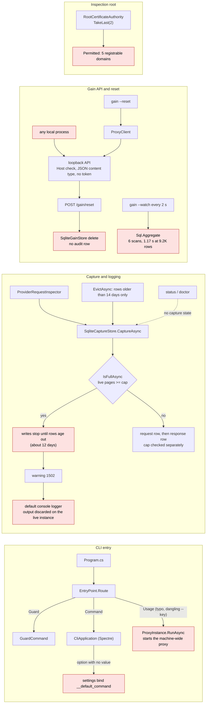
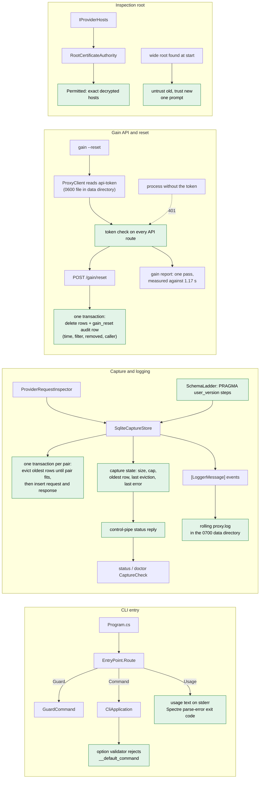

# Plan: Fix the 0.34.0 project-scope review findings

**Date:** 2026-11-21
**Input:** [2026-11-21-project-review.md](2026-11-21-project-review.md) at base `9d9c5b4` (0.34.0). Where the adversarial verification table corrected a number, this plan uses the corrected one.
**Owner rulings (2026-11-21):** fix every HIGH and MEDIUM finding (F1, F2, F3, F30, F31, F25, F4, F5, F6, F8, F9, F11, F13, F14, F15, F16, F17, F18, F19, F26, F27). F7 is LOW. Each LOW or NIT finding gets a characterization test that names it as not endorsed, or one line in the Deferred table. F5 narrows the root to exact hosts and rotates it once. F4 adds a reset audit row and a loopback API token. F25 adds a rolling log file and capture state in `status` and `doctor`. F3 and F30 keep capture running at its cap by evicting the oldest rows by bytes.

## How the campaign ships

There is one version bump for the whole campaign: 0.34.0 to 0.35.0. Each package is its own PR to `main`. The orchestrator writes `docs/changelog/0.35.0-project-review-fixes.md` with the first wave 1 merge and amends that one entry at the end of each wave. No lane edits VERSION or the changelog.

VERSION changes only in the last PR (package V). `release.yml` tags `main` the moment VERSION changes, so a bump in wave 1 would cut `v0.35.0` before waves 2 and 3 land. That is the F26 defect, done by the plan itself. Until V merges, nobody dispatches `publish.yml`.

## Current shape

Drawn from the verified facts in the review record. Red nodes are the defects this plan closes.

## Proposed shape

## Decision records before code

ADR numbers continue from 0016 (`docs/adr/README.md`). Package A writes them as Draft. The owner accepts each one before the packages that depend on it start.

| ADR | Decision | Amends | Blocks |
|---|---|---|---|
| 0017 | The root's name constraint lists the exact hosts `IProviderHosts` decrypts (provider and harness-only hosts), not their registrable parents. A root whose constraint differs from the current host set is untrusted and replaced at start, with one trust prompt. A new provider host therefore means a new root. The ADR also corrects the 0009 wording about the pfx password: it gives no protection at rest. | 0009 | P7 |
| 0018 | Every loopback API route needs a bearer token that the proxy writes at start to a 0600 file in the 0700 data directory. The CLI, the MCP child and `doctor` read it from there. Every gain reset writes a `gain_reset` row (UTC time, filter, removed count, caller) in the same transaction as the delete. | 0006, 0010 | P6 |
| 0019 | Capture keeps writing at its cap: it evicts the oldest rows by bytes in the transaction that inserts a request and response pair, and the 14-day age prune stays as a second bound. The proxy writes its log to a rolling `proxy.log` in the data directory (two files, fixed size, written by a small in-house `ILoggerProvider`). Capture state travels in the control-pipe status reply. | the capture rules of 0012 | P3, P4, P13 |
| 0020 | A retrieval follow-up send gets the same header deadline as the first send. When it expires, the relay ends the turn with an error event instead of sending pings forever. | 0005 relay section | P10 |
| 0021 | Each SQLite store stamps `PRAGMA user_version` and opens through an ordered ladder of steps. A file newer than the code refuses to open. | 0002 | P4, P5, P6 |

## Serialisation points

Each of these files is touched by more than one finding. The plan gives each file to one package per wave:

| File | Owner package (wave) | Why others wait |
|---|---|---|
| `src/AiProxy/ProxyServiceExtensions.cs` | P12 (W1), then P6 (W2) | P12 splits `AddCompression`. P6 adds the token check next to `UseMiddleware<RequestLoggingMiddleware>` (line 193). P3 and P7 must not edit it: P3 hooks logging in `ProxyInstance.cs`, and P7 gets the hosts through `TitaniumProxyService`, which already takes `IProviderHosts`. |
| `src/AiProxy/Cli/CliApplication.cs` | P1 (W1) | P6 changes the client through `ProxyClientServiceCollectionExtensions.cs` and leaves the registrations alone. |
| `src/AiProxy.Storage/SqliteCaptureStore.cs` | P4 (W1) | F3, F30, the F16 capture ladder and the F25 state source all live here, so they are one package. |
| `src/AiProxy.Storage/SqliteGainStore.cs` | P6 (W2) | F4 audit, F15 report and the F16 gain ladder are one package. |
| `src/AiProxy.Storage/SchemaLadder.cs` (new) | P4 (W1) | P5 and P6 reuse it in W2. |
| `src/AiProxy/Configuration/ProxySettings.cs`, `CcrSettings.cs`, `CompressionSettings.cs`, `docs/reference/environment-variables.md` | P10 (W1) | P3 adds no setting, and the log size is fixed. P4 keeps `CaptureMaxBytes` as it is. |
| `src/AiProxy/Doctor/*` | P6 owns `ApiCheck.cs`, P7 owns `RootCheck.cs`, P13 owns `DoctorRun.cs`, `DoctorView.cs` and the new `CaptureCheck.cs` (all W2) | Three W2 packages share the folder but not a file. |
| `VERSION`, `docs/changelog/0.35.0-project-review-fixes.md` | the orchestrator; VERSION only in V (W3) | See "How the campaign ships". |

## Packages

Every gate below must be seen red on the defect before the fix, and green after. The F2 test passed on the defect, so each gate also states what keeps it from passing vacuously. Patterns to follow in all packages: primary constructors, records for results, guard clauses, `[LoggerMessage]` methods in a nested `Log` class with an explicit EventId that is new for its class (the P14 uniqueness test catches a collision), and `[Range]` validation on settings as at `ProxySettings.cs:39`. Every package writes its test list with `design-tests` first and ends with `review-tests` by someone other than its author.

### A. Decision records (ADR 0017 to 0021)

- **Closes:** prerequisite for F3, F30, F25, F4, F5, F8, F16.
- **Files:** `docs/adr/0017-*.md` to `docs/adr/0021-*.md`, `docs/adr/README.md` (new rows, plus the Amended column for 0002, 0005, 0006, 0009, 0010, 0012).
- **Persona:** architect. **Effort:** M. **Depends on:** nothing.
- **Acceptance:** five Nygard-shaped records (Context, Decision, Consequences, Alternatives), each linked from the ADR it amends, each Accepted by the owner through `owner-gate-review`.
- **Gate:** the owner's per-decision ruling. Red is the Draft status in the index. An ADR has no executable gate, and this plan does not pretend it does.
- **Simpler alternative rejected:** one combined ADR for the campaign. Rejected because each amends a different earlier record, and a later reader looks up one decision, not one review.

### P1. CLI entry route and option values (F1, F31, F6)

- **Files:** `src/AiProxy/Program.cs`, `src/AiProxy/Cli/EntryPoint.cs`, `src/AiProxy/Cli/CliApplication.cs`, `src/AiProxy/Cli/{Stop,Gain,Replay,Status,Doctor}Settings.cs`; tests `EntryPointTests` plus a new process-level route test.
- **Persona:** dotnet-engineer. **Effort:** S. **Depends on:** nothing.
- **Acceptance:** `ai-proxy stauts`, `ai-proxy bogus` and `ai-proxy --Proxy:Port` print usage on stderr, exit with the same non-zero code Spectre uses for a parse error, and bind no port. `UsageExitCode = 2` is removed, so there is no clash with `doctor`'s 2. `stop --data-directory`, `gain --rule`, `gain --provider` and `replay --home` with no value are rejected with the option named, and no folder named `__default_command` is created.
- **Gate:** run the entry point as a child with a throwaway HOME and a free port for both the typo and the dangling `--key` branch. Assert a non-zero exit within 5 s and that the port is still free afterwards. *Not vacuous because:* the lane runs stopped only because the live proxy held the port. The test picks a port that is known to be free, so a start would succeed and be seen, and it covers both branches of F31. The option test asserts that the folder does not exist, not only the exit code.
- **Simpler alternative rejected:** map `Usage` to an early return in `Program.cs` only. Rejected because it leaves F6, a separate exit code, and a second error path beside Spectre's.

### P2. Gain and replay tables fit 80 columns without wrapping (F2)

- **Files:** `src/AiProxy/Cli/GainView.cs`, `src/AiProxy/Cli/ReplayView.cs`, `tests/AiProxy.Tests/Unit/Cli/GainViewLayoutTests.cs`, replay view tests.
- **Persona:** dotnet-engineer. **Effort:** M. **Depends on:** nothing (ADR 0014 already rules the target).
- **Acceptance:** with the three harness rows in the live shape and values such as `235.4M`, every table row renders on exactly one line at 80 columns. No header or number is split (`Save│d`, `Reca│ll`, `235.4│M`), and the replay kind table shows both `Preview` headers whole.
- **Gate:** render at 80 columns and assert that the number of lines equals header plus rows plus borders, and that every expected header and number string appears whole on one line. *Not vacuous because:* the old test checked only `line.Length <= 80`, which Spectre satisfies by wrapping. A line count and whole-token search fail on any continuation line. Watch it fail on the current view with the live-shape rows first.
- **Simpler alternative rejected:** widen the test to 100 columns. Rejected because ADR 0014 rules 80.

### P3. Rolling log file (F25, part 1)

- **Files:** `src/AiProxy/Hosting/Proxy/ProxyInstance.cs`, new `src/AiProxy/Hosting/Proxy/ProxyLogFile.cs` (the provider), `docs/reference/lifecycle.md`.
- **Persona:** dotnet-engineer. **Effort:** M. **Depends on:** A (0019).
- **Acceptance:** the proxy writes every log event to `<data-directory>/proxy.log`. At a fixed size the file rolls to `proxy.1.log`, and the two files together never exceed twice that size. Console output stays as it is. The file is created inside the 0700 directory with 0600 mode on POSIX.
- **Gate:** an integration test starts a proxy child on a throwaway HOME with its stdout and stderr discarded, forces warning 1502 or a later capture event, and finds that EventId in `proxy.log`. A unit test with a tiny size proves the roll and the bound. *Not vacuous because:* the child's console output goes nowhere, so the console cannot be the source, and the test matches the EventId, not any line.
- **Measurement chain:** P3 merges before P4, so the first live run of byte eviction is visible in the file.
- **Simpler alternative rejected:** Serilog with a file sink. Rejected because it adds two packages and a second configuration surface for one file, and the 56 source-generated log methods need only a sink.

### P4. Capture keeps running at its cap (F3, F30, F16 for capture.db, F25 state source)

- **Files:** `src/AiProxy.Storage/SqliteCaptureStore.cs`, new `src/AiProxy.Storage/SchemaLadder.cs`, capture store tests.
- **Persona:** dotnet-engineer. **Effort:** M. **Depends on:** A (0019, 0021).
- **Acceptance:** at the cap, a new request and response pair is stored after the oldest rows are deleted until the pair fits. Live pages stay at or below the cap. A request row is never kept without its response, because the cap is checked once per pair in one transaction. The 14-day prune still runs. The store exposes a `CaptureState` record (size, cap, oldest row time, last eviction, last write error). capture.db opens through the ladder and moves from `user_version` 0 to 1.
- **Gate:** fill a store with a 64 KiB cap with rows that are all younger than 14 days, write one more pair, and assert that the newest pair is present, the oldest rows are gone, and the page size is at or below the cap. *Not vacuous because:* the current stop-at-cap code also keeps the size under the cap, so the test asserts that the newest pair is present. The rows are younger than the retention window, so the age prune cannot be what frees the space. Ladder gate: create a file with the 0.34.0 DDL and `user_version` 0, open it, and assert version 1. Red today, because the version stays 0.
- **Simpler alternative rejected:** raise the default cap to 13 GB. Rejected because that postpones the stop (F30 shows how), and the owner ruled eviction.

### P5. Content store eviction stays inside the request-path wait (F14, F16 for content.db)

- **Files:** `src/AiProxy.Storage/ContentRetention.cs`, `ContentSchema.cs`, `SqliteContentStore.cs`, their tests.
- **Persona:** dotnet-engineer. **Effort:** S. **Depends on:** P4 (`SchemaLadder.cs`), A (0021).
- **Acceptance:** one eviction batch deletes at most a fixed byte budget (for example 16 MB), so a batch of 500 KB rows does not hold the write lock for about 1 s. content.db uses the ladder, and its declared `SchemaVersion = 3` becomes the stamped `user_version`. Whether content.db also gets a byte cap is an owner question below.
- **Gate:** a counting test with 1,000 rows of 500 KB asserts that one batch removes at most the byte budget. *Not vacuous because:* it counts bytes per batch through the delete result, not wall-clock time, and the rows are large enough that the current 1,000-row batch (about 500 MB) breaks the budget.
- **Simpler alternative rejected:** lower the batch from 1,000 rows to 30. Rejected because row size varies by three orders of magnitude, so a row count cannot bound lock time.

### P6. Gain ledger and loopback API token (F4, F15, F16 for gain.db)

- **Files:** `src/AiProxy.Storage/SqliteGainStore.cs`, `src/AiProxy/Hosting/Api/GainEndpoints.cs`, new `src/AiProxy/Hosting/Api/ApiToken.cs`, `src/AiProxy/ProxyServiceExtensions.cs` (token check only), `src/AiProxy/Hosting/Proxy/ProxyDataDirectory.cs` (token file), `src/AiProxy/Client/ProxyClient.cs`, `src/AiProxy/Client/ProxyClientServiceCollectionExtensions.cs`, `src/AiProxy/Cli/GainCommand.cs`, `src/AiProxy/Cli/GainWatch.cs`, `src/AiProxy/Doctor/ApiCheck.cs`.
- **Persona:** dotnet-engineer. **Effort:** L, in four commits: ladder, audit, token, report.
- **Depends on:** A (0018, 0021), P4 (ladder), P12 (`ProxyServiceExtensions.cs`).
- **Acceptance:** each reset, from the CLI or over HTTP, writes one `gain_reset` row in the same transaction as the delete, with UTC time, the filter, the removed count and the caller (the client names itself, for example `cli gain --reset pid 1234`). Every API route answers 401 without the token. The CLI, the MCP retrieval tools and `doctor` send it, and the token file is 0600 and is rewritten at each start. The snapshot guard against backdated inserts gets its own test. The gain report runs in one pass, and the time on a copy of the live gain.db is recorded against the 1.17 s baseline.
- **Gate:** (1) reset through the API with a filter, then read `gain_reset` and assert the row's filter and count equal what was deleted. Red today, because the table does not exist. (2) `POST /gain/reset` without the token returns 401 and deletes nothing. Red today: 200. (3) Mutation for the snapshot guard: remove the guard and watch its new test fail. *Not vacuous because:* the audit assertion compares the count with rows that existed before the reset (seeded, non-zero), and the 401 test checks that the rows are still there, not only the status code.
- **Ships as one:** the token check and the clients that send the token cannot be split. Half of them would break `gain` and MCP retrieval between merges.
- **Measurement chain:** time the F15 report on the same gain.db copy before and after, and put both numbers in the changelog.
- **Simpler alternative rejected:** remove `POST /gain/reset` and keep only the CLI path. Rejected because the CLI reaches the store through that same API (ADR 0006), so the route is the only path.

### P7. Root CA names exact hosts, rotated once (F5)

- **Files:** `src/AiProxy/Hosting/Integration/RootCertificateAuthority.cs`, `RootCertificateFiles.cs`, `TitaniumProxyService.cs` (passes `IProviderHosts`, runs untrust and trust, clears the leaf cache), `src/AiProxy/Doctor/RootCheck.cs`.
- **Persona:** dotnet-engineer. **Effort:** M. **Depends on:** A (0017).
- **Acceptance:** a new root's permitted DNS subtrees equal the decrypted host set, harness-only `chatgpt.com` hosts included. At start, a root whose constraint differs from that set is untrusted by thumbprint, deleted and replaced, and the new root is trusted with one prompt. A second start with a matching root does nothing. Leaf certificates signed by the old root are not reused. `doctor` warns on a wide root.
- **Gate:** generate with a fake `IProviderHosts` that holds a host whose registrable parent differs from the host (`api.anthropic.com`), and assert that the permitted list is exactly the fake set. Red today because `TakeLast(2)` yields `anthropic.com`. Migration test with a fake `IRootTrust`: a root made the old way gets exactly one untrust call (old thumbprint) and one trust call; a narrow root gets none. *Not vacuous because:* with a host list of bare registrable domains, exact and parent would be equal, so the fake set must contain subdomains. The rotation test counts calls in both directions.
- **Ships as one:** narrowing without rotation leaves the wide root trusted beside the new one.
- **Simpler alternative rejected:** narrow new roots only and tell the user to delete the old one. Rejected because the owner ruled detect and replace.

### P9. Compression core correctness (F17, F18, F11)

- **Files:** `src/AiProxy.Core/Content/ContentDecompositor.cs`, `MustKeepOverlay.cs`, `Ccr/ChatRequest.cs`, their tests (the skipped wall-clock test at `ContentDecompositorTests.cs:156` is deleted).
- **Persona:** dotnet-engineer. **Effort:** M. **Depends on:** nothing.
- **Acceptance:** the decompositor's failed-structure attempts are counted and bounded at 32. A numbered read's overlay holds identifiers and no bare line numbers. `ChatRequest.Prepare` adds `include_usage` inside an existing `stream_options` by a byte splice, and every other byte stays the same.
- **Gate:** F17: a counting test on an input with more than 32 failing candidate structures. The mutation `MaxFailedStructureAttempts = int.MaxValue` must turn it red (today the full suite stays green under that mutation). F18: on a 1,500-line numbered read, the overlay is non-empty, holds named identifiers from the read and holds no all-digit token. Red today: 57 of 57 are numbers. F11: a body with `"stream_options": {}`, extra whitespace, a `é` escape and `1.0E2` keeps every byte outside the inserted span. *Not vacuous because:* the F17 input passes the bound, the F18 test requires a non-empty overlay (an empty one would also have no numbers), and the F11 body uses forms that `System.Text.Json` rewrites, where a compact ASCII body would pass on the defect.
- **Measurement chain:** F18 and F11 change what replay measures, and the token-return work reads replay. P9 merges early in W1, and replay over the same captured bodies runs before and after, with both numbers in the changelog.
- **Simpler alternative rejected:** for F11, document that the `WithUsage` branch may change bytes. Rejected because it breaks the prompt-cache promise the method was written for.

### P10. Retrieval follow-up deadline and setting ranges (F8, F19)

- **Files:** `src/AiProxy/Ccr/CcrRelay.cs`, `src/AiProxy/Configuration/CcrSettings.cs`, `CompressionSettings.cs`, `ProxySettings.cs` (doc only if needed), `docs/reference/environment-variables.md`.
- **Persona:** dotnet-engineer. **Effort:** M. **Depends on:** A (0020).
- **Acceptance:** the follow-up send has the header deadline of the first send, and on expiry the client gets an error event and the turn ends. `Proxy:Ccr:KeepAliveInterval` must be positive, and `Proxy:Compression:Minimum` must be at least 1. Both are rejected at start with the key named. All bound keys, including `Compression:CodeViews`, `Ccr:Enabled`, `Ccr:UnknownProviders`, `Ccr:KeepAliveInterval` and `RootCertificatePassword`, are in the settings reference.
- **Gate:** F8: a fake upstream accepts the follow-up and never sends headers while it keeps the socket open. With a short deadline from a fake `TimeProvider`, assert an error event within the deadline. F19: options validation tests for 0 and -5 ms, and a doc test that derives the bound keys by reflection over the settings types and finds each one in `environment-variables.md`. Red today for five keys. *Not vacuous because:* a closed socket fails fast on the current code too, so the fake keeps it open with pings on. The doc test derives the list and does not copy it.
- **Simpler alternative rejected:** set `HttpClient.Timeout` to 10 minutes. Rejected because the timeout would also cut a long, healthy streamed response, while a header deadline does not.

### P11. MCP retrieval schema matches the API (F9)

- **Files:** `src/AiProxy.Core/Content/Ccr/CcrRetrieval.cs`, `src/AiProxy/Mcp/RetrievalTools.cs`, their tests.
- **Persona:** dotnet-engineer. **Effort:** S. **Depends on:** nothing.
- **Acceptance:** `tools/list` shows `mode` as the enum, `context` as 0 to 10, `minimum: 1` where the API has it, and the 16-hex id pattern. A `bad_input` error names the allowed values.
- **Gate:** a test reads the published input schema and asserts that it equals the one definition the API validates against. Red today. *Not vacuous because:* both sides are built from one source, and the test asserts the enum values and bounds, not only that the property exists. A live `tools/list` check is part of the W1 smoke, because the adversarial pass did not re-check F9.
- **Simpler alternative rejected:** a hand-written description string listing the values. Rejected because it drifts from the validator.

### P12. Replay composition cannot reach the live stores (F13)

- **Files:** `src/AiProxy/ProxyServiceExtensions.cs` (split `AddCompression` into the pure pipeline and the SQLite adapters), `src/AiProxy/Replay/ReplayEngine.cs`, `tests/AiProxy.Tests/Unit/ClientBoundaryTests.cs`.
- **Persona:** dotnet-engineer. **Effort:** M. **Depends on:** nothing.
- **Acceptance:** replay registers only the pipeline and its own read-only stores. The boundary test follows the full dependency chain, not one hop, from every client root, with `McpCommand`, `HarnessProcess` and the `Doctor` types added.
- **Gate:** the mutation is a pipeline type three hops from replay that takes `IContentQueue` in its constructor. The new test must go red and the old one-hop test stays green, which shows the gap. A replay run on a HOME without content.db must leave no content.db behind. *Not vacuous because:* the mutation sits at the depth the record says the old test misses.
- **Simpler alternative rejected:** a comment that replay must override two stores. Rejected because a comment does not fail a build.

### P13. Capture state in `status` and `doctor` (F25, part 2)

- **Files:** `src/AiProxy/Hosting/Proxy/ProxyControl.cs` (status reply field), `src/AiProxy/Cli/StatusCommand.cs`, `StatusView.cs`, `src/AiProxy/Doctor/DoctorRun.cs`, `DoctorView.cs`, new `src/AiProxy/Doctor/CaptureCheck.cs`, `docs/reference/doctor.md`.
- **Persona:** dotnet-engineer. **Effort:** S. **Depends on:** P3, P4, A (0019).
- **Acceptance:** `status` shows capture on or off, size against the cap, the oldest row, the last eviction and the last write error, and the path of `proxy.log`. `doctor` warns when the last write failed or when capture is off while configured on. The state comes from the control pipe as ADR 0010 already uses it, so `status` still takes no lock and needs no token.
- **Gate:** a fake pipe reply with capture at its cap and a write error in the last hour. Assert that `status` prints those values and that `doctor` returns the warning code. Red today, because neither mentions capture. *Not vacuous because:* the fake carries non-default values and the test asserts them, not only the word "capture".
- **Simpler alternative rejected:** `doctor` greps `proxy.log` for 1502. Rejected because a rolled file loses the line, and text in a log is not a contract.

### P14. Characterization tests for LOW findings (F7, F10, F12, F23 two items)

- **Files:** test files only: `ToolOutputRegionFinder` tests, `ChatRound` tests, new `tests/AiProxy.Tests/Unit/LogEventIdTests.cs`, a new pass-through header test, a preview-header test.
- **Persona:** test-engineer. **Effort:** S. **Depends on:** nothing. Merge early in W1, because the EventId test guards every later package.
- **Acceptance:** each test is named `..._not_endorsed` and its doc line names the finding. F7: a lone-surrogate tool result makes the inspector forward the body unchanged. F10: a Chat Completions retrieval reads `choices`, so replacing the literal with `ChatApi.Fields.Choices` (`"n"`) fails. F12: every `[LoggerMessage]` EventId is unique across the assembly except the three known pairs (1201, 1202, 1601), which are listed, and the test fails if a listed pair disappears, so the list stays true. F23: the plain-HTTP pass-through forwards `Connection`-named headers and `TE` (echo origin). A tool output that contains a preview header is not previewed.
- **Gate:** for each test, apply the mutation it names (the `Choices` replacement, a new duplicate EventId, removing the catch in the inspector) and watch it go red. *Not vacuous because:* each test asserts the exact current behaviour, so the named mutation changes the result.
- **Simpler alternative rejected:** put all of them in the Deferred table. Rejected for these five because each hides a trap that a later cleanup would fall into without a test.

### P8. CI version check and publish from the tag (F26, F27)

- **Files:** `.github/workflows/build.yml`, `publish.yml`, `lifecycle.yml`; the `main` ruleset (owner, admin API).
- **Persona:** dotnet-engineer. **Effort:** M. **Depends on:** all code packages merged (see below).
- **Acceptance:** a PR that changes `src/` fails unless VERSION is greater than the latest `v*` release tag and its changelog entry exists. The check compares with the last release, not with the base branch, so the campaign's PRs merged without a bump before V do not block each other. `publish.yml` checks out `refs/tags/v$(VERSION)` and fails if the tag is missing. `lifecycle` does not cancel in progress on `main`. `lifecycle (windows-2025)` and `installed-tool` become required, and `lifecycle.yml` gets the `changes`-job pattern from `build.yml` first, because a path-filtered required check never reports on a doc-only PR.
- **Gate:** on a scratch branch, a one-line `src/` change without a bump makes the new job red, and with a bump it is green. The publish tag step is run against a commit whose VERSION has no tag and fails. The ruleset gate is `gh api repos/{owner}/{repo}/rules/branches/main` listing both contexts. Red today. *Not vacuous because:* the old check passed whenever any changelog for the current VERSION existed, which is always after a release. The new one compares against the tag.
- **Order:** P8 merges in W3 before V. It changes no `src/` file, so it passes its own check. V then satisfies it.
- **Simpler alternative rejected:** a PR template checkbox. Rejected because nothing checks a checkbox.

### V. Release 0.35.0

- **Files:** `VERSION`, `docs/changelog/0.35.0-project-review-fixes.md` (final amend), ADR statuses as needed.
- **Persona:** the orchestrator. **Effort:** S. **Depends on:** every other package.
- **Gate:** `release.yml` refuses a VERSION without its changelog entry. Red first by checking out the bump without the entry locally and running the validation step. The new P8 check must pass on this PR.
- **After merge:** the owner dispatches `publish.yml`. The live proxy restarts on 0.35.0 without the shell redirect to `~/.ai-proxy/proxy.log`, because P3's provider writes that file and a redirect would write each line twice. The first start shows one trust prompt for the rotated root.

## Package table

| Id | Title | Findings | Persona | Effort | Depends on | Wave |
|---|---|---|---|---|---|---|
| A | ADRs 0017 to 0021 | prerequisite | architect | M | none | W0 |
| P1 | CLI entry route and option values | F1, F31, F6 | dotnet-engineer | S | none | W1 |
| P2 | Tables fit 80 columns | F2 | dotnet-engineer | M | none | W1 |
| P3 | Rolling log file | F25 (1) | dotnet-engineer | M | A | W1 |
| P4 | Capture evicts at cap, capture ladder, state | F3, F30, F16, F25 (source) | dotnet-engineer | M | A | W1 |
| P9 | Compression core correctness | F17, F18, F11 | dotnet-engineer | M | none | W1 |
| P10 | Follow-up deadline, setting ranges | F8, F19 | dotnet-engineer | M | A | W1 |
| P11 | MCP schema matches API | F9 | dotnet-engineer | S | none | W1 |
| P12 | Replay composition boundary | F13 | dotnet-engineer | M | none | W1 |
| P14 | LOW characterization tests | F7, F10, F12, F23 (2) | test-engineer | S | none | W1 |
| P5 | Content eviction by bytes, content ladder | F14, F16 | dotnet-engineer | S | P4, A | W2 |
| P6 | Gain audit, API token, report speed, gain ladder | F4, F15, F16 | dotnet-engineer | L | P4, P12, A | W2 |
| P7 | Root exact hosts and rotation | F5 | dotnet-engineer | M | A | W2 |
| P13 | Capture state in status and doctor | F25 (2) | dotnet-engineer | S | P3, P4, A | W2 |
| P8 | CI version check, publish from tag, required lanes | F26, F27 | dotnet-engineer | M | W1, W2 | W3 |
| V | Release 0.35.0 | all | orchestrator | S | all | W3 |

## Waves

- **W0:** A. P1, P2, P9, P11, P12 and P14 need no ADR and start at the same time as A.
- **W1:** nine packages, and no two share a file (see Serialisation points). Each runs in its own worktree. Merge order inside the wave: P14 first (EventId guard), then P9 (measurement chain), then P3 before P4, then the rest. The orchestrator then amends the changelog entry.
- **W2:** P5, P6, P7, P13 in parallel. They share no file: the `Doctor/` files are split as listed, and only P6 edits `ProxyServiceExtensions.cs`. The changelog is amended at the end.
- **W3:** P8, then V. These are serial, because V must satisfy the check P8 adds.

## Deferred

| Finding | Why deferred |
|---|---|
| F20 `gain` socket error, `replay` on a missing folder exits 0 | The fix is in `ProxyClient` and `ReplayCommand`. P6 owns `ProxyClient` this campaign, and the fix waits for the next CLI error pass. |
| F21 Net beside a negative billed balance | Both measures are ruled in the how-to. A wording change needs its own design. |
| F22 two flaky tests and a 10 s child deadline | Neither flake reproduced in 22 runs. Add failure detail when one next fails, then fix with evidence. |
| F23 `TitaniumProxyService` at 553 lines | P7 changes it for security. A split in the same campaign would mix a refactor into that change. |
| F23 `Hosting/Integration` is a technical bucket | Moving 19 files during parallel lanes breaks every lane's merge. Do it after V. |
| F23 content decoding in three places | No defect is known. Consolidate it when zstd next changes. |
| F23 `GainHarness` repeats hosts | P7 makes the root use `IProviderHosts`. Move the harness rows to the same source after V. |
| F23 `lines` retrieval numbers twice | ADR 0005:66 rules this behaviour. |
| F23 five `?? throw` lookups, 29 hand-rolled throws | Touches CLI files that P1 and P6 edit. A guard-clause pass follows V. |
| F23 Windows ACL on a configured data directory | Not measured. See Still open. |
| F23 doc remark cites Titanium 7.0.26 | NIT. Fix with the next edit of that file. |
| F23 three child-process tests without an isolated HOME | See owner question 4. The same hazard stopped the live proxy on 2026-11-05. |
| F23 `--data-directory` and `--home` name one concept | A rename breaks scripts and needs its own decision. |
| F23 three seams with one implementation | No test double needs them yet. Leave them. |
| F24 0.7% of request bytes removed | An observation, not a defect. P9's before and after replay gives the next number. |
| F28 `labeled` trigger cancels the first CI run | One line in `build.yml`. See owner question 4. |
| F29 NuGet audit warnings suppressed | Nothing is hidden today. A dependency-alert process is a separate decision. |

## Still open

- The cause of the 2026-11-11 gain reset stays unknown. P6 makes the next reset traceable but cannot recover that one.
- F9 and the F13 three-hop chain were not re-checked by the adversarial pass. P11 and P12 gates settle both.
- Windows ACLs on a configured data directory, and Titanium 8.0.2's default upstream validation, are not measured. ADR 0018 puts a token file there, so the Windows ACL gap now covers a secret too.
- Live thread-mode continuation and `--restart` end to end were not exercised. P10 changes the relay, so the W1 smoke must run one live retrieval follow-up.
- How Titanium caches leaf certificates across a root change needs a check against the 8.0.2 source before P7 starts.
- The one-week capture for the token-return work (to about 2026-11-27) fits under 8 GiB at 37.9 MB per hour (about 9 days). If 0.35.0 goes live after that, eviction starts to remove its oldest rows.

## Owner questions

1. **content.db byte cap (F14).** ADR 0008 keeps originals for 14 days so a preview can still be retrieved. At about 78 MB per day the file settles near 1.1 GB. P5 fixes the lock time only. Do you also want a byte cap, which would make an older preview unrecoverable inside the 14 days?
2. **Token scope (F4).** The plan requires the token on every loopback API route, retrieval included, so a process without the file cannot read originals either. Do you agree, or do you want it on the reset route only?
3. **Release order.** The token-return open-items task may also want 0.35.0. Which ships first, and does this campaign take 0.35.0 or the version after it?
4. **One-line LOW fixes in files a package already edits.** F28 (`build.yml`, P8) and the three tests without an isolated HOME. Do you allow fixing them inside the package, or do they stay deferred as your ruling says?
5. **Required Windows and macOS lanes (F27).** While merges use `--admin` by standing order, required checks do not block. Do you still want them required, and will you run the ruleset change (it needs admin)?
